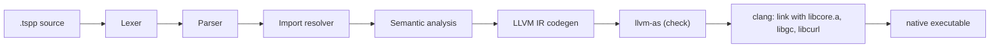

# tspp

<div align="center">


**TypeScript syntax with C++-level memory control, compiled to native via LLVM.
Safe by default, unsafe when you ask for it.**

[](https://github.com/tspp-io/tspp-compiler/actions/workflows/ci.yml)
[](LICENSE)

</div>

tspp is an experimental compiler. It takes a TypeScript-like language, checks it,
lowers it to LLVM IR with the LLVM C++ API, and links it with `clang` against a
small C++ runtime and the Boehm garbage collector. The output is a native
executable. There is no interpreter and no JIT.

**Status: early prototype (v0.1.0).** The core of the language (functions,
integers, strings, classes, control flow, globals, imports) compiles and runs.
The parts that make tspp *tspp* — explicit memory regions, smart pointers,
`@unsafe` pointers — are parsed but have no semantics yet. This README lists
only features that have a passing test; everything else is under
[Planned](#planned) or [Known limitations](#known-limitations).

## Hello, world

```tspp
function main(): int {
  console.log("Hello, tspp!");
  return 0;
}
```

```bash
./build/src/tspp hello.tspp        # compile, link and run
# Hello, tspp!
./build/src/tspp -o hello hello.tspp && ./hello   # build only, then run
```

This program is [`tests/examples/hello.tspp`](tests/examples/hello.tspp).

## Works today

Each item links the test that proves it. The suite (`tests/run.sh`) runs on
every push in CI.

| Feature | Test |
|---|---|
| Functions: parameters, return types, recursion, default arguments | [`examples/tour.tspp`](tests/examples/tour.tspp), [`basics/ints_control_flow.tspp`](tests/basics/ints_control_flow.tspp) |
| `let` / `const`, typed or inferred; `typedef` aliases | [`examples/tour.tspp`](tests/examples/tour.tspp) |
| `int` arithmetic, bitwise and shift operators, comparisons, `&&`/`\|\|` short-circuit, `+=` and friends, `++`/`--`, `?:`, with TypeScript/C operator precedence | [`basics/ints_control_flow.tspp`](tests/basics/ints_control_flow.tspp), [`regression/h3_precedence_table.tspp`](tests/regression/h3_precedence_table.tspp) |
| `boolean` (and its alias `bool`) | [`regression/h4_boolean.tspp`](tests/regression/h4_boolean.tspp), [`regression/h4_boolean_bool.tspp`](tests/regression/h4_boolean_bool.tspp) |
| `if`/`else`, `while`, C-style `for` (all header forms); statements spanning lines without `;` | [`basics/ints_control_flow.tspp`](tests/basics/ints_control_flow.tspp), [`basics/multiline_statements.tspp`](tests/basics/multiline_statements.tspp), [`basics/function_ends.tspp`](tests/basics/function_ends.tspp) |
| Strings: literals, `+` with strings, ints and booleans; garbage-collected | [`regression/c1_strings_survive.tspp`](tests/regression/c1_strings_survive.tspp), [`regression/c1_concat_loop.tspp`](tests/regression/c1_concat_loop.tspp) |
| Classes: fields, constructors, methods, `extends` + `super`, `#override`, `implements`, generic classes (`Box<T>`) | [`basics/classes_strings.tspp`](tests/basics/classes_strings.tspp), [`examples/tour.tspp`](tests/examples/tour.tspp) |
| `int` arrays: literals, indexing, element assignment | [`basics/classes_strings.tspp`](tests/basics/classes_strings.tspp) |
| Globals with any initializer, class `#static` fields and `static {}` blocks, top-level statements: all run once, in source order, before `main` | [`globals/`](tests/globals) |
| `import X from "./file"` (textual merge; the imported file's startup code runs first) | [`globals/import_order.tspp`](tests/globals/import_order.tspp) |
| `console.log`; runtime calls `sys.get_platform`, `sys.read_file`/`write_file`/`delete_file`, `sys.get_cwd`/`set_cwd` | [`sys_test.tspp`](tests/sys_test.tspp), [`regression/c1b_read_file.tspp`](tests/regression/c1b_read_file.tspp), [`regression/c1b_get_cwd.tspp`](tests/regression/c1b_get_cwd.tspp) |
| Errors with `file:line:col` for lexer, parser, import and semantic errors; invalid generated IR is caught (`llvm::verifyModule`) instead of miscompiled | [`diagnostics/`](tests/diagnostics) |
| Driver: compile and run, `-o`, `--emit-llvm`, `--keep-temps`, `--asan`, `--version`; works from any directory; never invokes a shell | [`driver/cli.sh`](tests/driver/cli.sh), [`driver/run_from_other_dir.sh`](tests/driver/run_from_other_dir.sh), [`driver/shell_injection.sh`](tests/driver/shell_injection.sh) |
| REPL (`tspp` with no arguments): each input is compiled and run as its own program | [`driver/repl.sh`](tests/driver/repl.sh) |

**Parsed, no behavior yet** (parse-only tests): class and member modifiers
such as `#packed`, `#abstract`, `#final`, `#inline`, `#virtual`, `#readonly`,
`#atomic` ([`modifiers/`](tests/modifiers)); generic constraints
(`<T extends int>`) and union types in type aliases
([`types/generics_parse.tspp`](tests/types/generics_parse.tspp)).

### A short tour

This is [`tests/examples/tour.tspp`](tests/examples/tour.tspp):

```tspp
typedef Score = int;
const LIMIT: int = 3;

interface Shape {
  area(): int;
}

class Square implements Shape {
  side: int;
  constructor(side: int) { this.side = side; }
  function area(): int { return this.side * this.side; }
}

function scaled(x: int, factor: int = 10): int {
  return x * factor;
}

function fact(n: int): int {
  if (n <= 1) {
    return 1;
  }
  return n * fact(n - 1);
}

function main(): int {
  let best: Score = 0;
  for (let i: int = 1; i <= LIMIT; i++) {
    let sq: Square = new Square(i);
    if (sq.area() > best) {
      best = sq.area();
    }
  }
  console.log("best area: " + best);
  console.log("scaled: " + scaled(4) + ", " + scaled(4, 2));
  console.log("5! = " + fact(5));
  return 0;
}
```

Output:

```text
best area: 9
scaled: 40, 8
5! = 120
```

## Known limitations

These are bugs or gaps in things that otherwise look supported. The full list,
with IDs, is in [`docs/KNOWLEDGE_TRANSFER.md` §9](docs/KNOWLEDGE_TRANSFER.md#9-known-issues-and-technical-debt).

- **Floats print wrong.** `float` values print as `0.000000` (the IR and the
  runtime disagree on `float` vs `double`). Float arithmetic itself compiles.
- **Integer conditions** (`if (n)`, `while (n)`) are not converted to booleans;
  the compiler stops with an internal compiler error. Write `if (n != 0)`.
- **Strings:** escape sequences (`"\n"`) are not processed; `==`/`!=` on strings
  compare pointers, not contents.
- **Arrays** hold `int` elements only and are not bounds-checked.
- **Smart-pointer types** (`#shared<T>`, `#unique<T>`, `#weak<T>`) do not parse
  yet, and `>>` closing nested generics (`A<B<int>>`) is read as a shift.
- `switch`, `do`/`while`, `for..of`, `try`/`catch`/`throw`, `break`/`continue`
  parse but are rejected by code generation with a clear error.
- `enum` and `namespace` are rejected ("not supported yet").
- Imports have no namespaces (`import {x} from` is not supported); a missing
  import is only a warning.
- Some untyped or mixed-type string expressions print an address instead of
  the string (string-typed `?:` inside `+`, `let w = "v" + f()` without a type
  annotation, static string members).
- The REPL keeps no state between inputs.

## Planned

The roadmap is [`ROADMAP.md`](ROADMAP.md). In order:

1. Typed arrays with bounds checks.
2. Split the code generator into maintainable pieces.
3. Real `#heap` allocation (today `#stack`/`#heap`/`#static` are parsed;
   `#heap` is ignored).
4. `#unique<T>`, then `#shared<T>` / `#weak<T>`.
5. `@unsafe` / `@aligned` raw-pointer semantics.

What the memory model is meant to look like (**planned, does not compile today**):

```tspp-planned
class Buffer {
  constructor(size: int) {}
}

function fill(): void {
  #heap let big: Buffer = new Buffer(4096);       // explicit heap allocation
  let owner: #unique<Buffer> = new Buffer(64);    // freed when owner goes out of scope
  let shared: #shared<Buffer> = new Buffer(64);   // reference counted
}
```

`#simd`, `#zerocast`, `#prefetch`, `#atomic`, `#pinned`, `#const` and
`#constexpr` are accepted by the parser and recorded as attributes, but have
no effect. They are planned after the memory model.

### Future ideas

Not planned yet: Go-style concurrency (goroutines, channels, `select`,
`defer`), a standard library beyond the `sys.*` runtime calls, and an
optimization pipeline of our own (today `clang -O3` optimizes the IR).

## Building

You need:

- a C++17 compiler (GCC or Clang) and CMake 3.14+
- **LLVM 17 or newer** with development files (`LLVMConfig.cmake`, shared
  `libLLVM`), plus `clang` and `llvm-as` on `PATH`. Tested with LLVM 17, 18, 22
  and 23.
- Boehm GC (`libgc`) and libcurl, both with development headers

Install scripts (read them first; the Ubuntu one adds apt.llvm.org):

```bash
sudo ./scripts/install_deps_ubuntu.sh   # Debian/Ubuntu
sudo ./scripts/install_deps_fedora.sh   # Fedora/RHEL
sudo ./scripts/install_deps_arch.sh     # Arch
./scripts/install_deps_macos.sh         # macOS (Homebrew)
```

Or with your package manager: install `cmake`, an LLVM ≥ 17 dev package and
the matching `clang`, Boehm GC (`libgc-dev` / `gc-devel` / `bdw-gc`) and
libcurl (`libcurl4-openssl-dev` / `libcurl-devel` / `curl`). If CMake does not
find LLVM, point it at it: `./build.sh -- -DLLVM_DIR=/usr/lib/llvm-18/lib/cmake/llvm`.
See [`docs/dev-setup.md`](docs/dev-setup.md).

Build and test:

```bash
git clone https://github.com/tspp-io/tspp-compiler.git
cd tspp-compiler
./build.sh               # Debug build (compiler built with ASan) in build/
./build.sh --release     # Release build in build-release/
tests/run.sh             # full test suite
./build/src/tspp --help
```

The compiler is `build/src/tspp`. It finds its runtime (`libcore.a`) next to
itself, so it works from any directory.

## How it works



See [`docs/architecture.md`](docs/architecture.md) for where each stage lives,
and [`docs/KNOWLEDGE_TRANSFER.md`](docs/KNOWLEDGE_TRANSFER.md) for the long
version.

## Documentation

- [Language overview](docs/language_spec.md): what the language accepts today,
  and program startup order
- [Grammar](docs/grammar.md): EBNF, including operator precedence
- [Architecture](docs/architecture.md) and [pipeline](docs/pipeline.md)
- [Development setup](docs/dev-setup.md)
- [Tests](tests/README.md): how the suite works and how to add a test
- [Roadmap](ROADMAP.md)

Code samples in these docs are compiled by `scripts/check_doc_samples.sh`,
which the test suite runs.

## Contributing

See [CONTRIBUTING.md](CONTRIBUTING.md). Bugs and feature requests:
[GitHub issues](https://github.com/tspp-io/tspp-compiler/issues). Security
issues: see [SECURITY.md](SECURITY.md) (please don't open a public issue).

## License

MIT, see [LICENSE](LICENSE).

## Acknowledgments

The [LLVM project](https://llvm.org/), the
[Boehm-Demers-Weiser garbage collector](https://www.hboehm.info/gc/), and
TypeScript, for the syntax.
