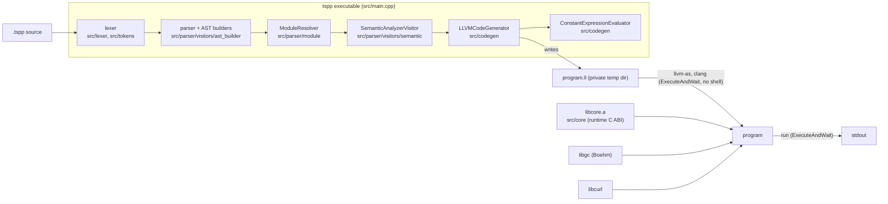
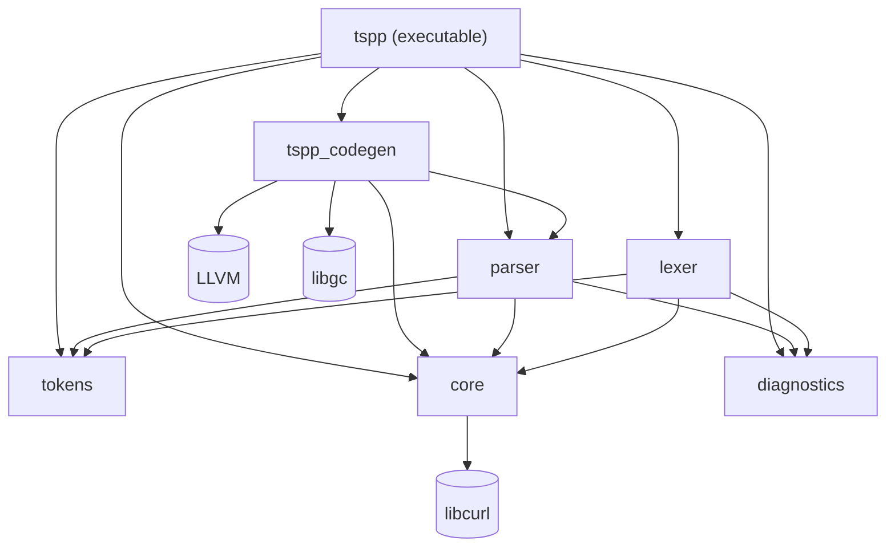
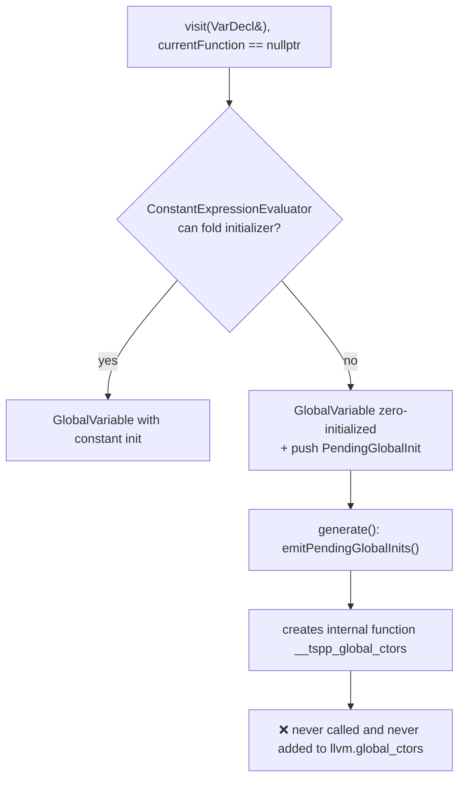

# tspp Compiler: Knowledge Transfer

> **Audience:** a developer who has never worked on this repository.
> **Snapshot:** commit `a10b0af` on `master` (last commit dated 2026-01-05). Written 2026-10-07.
> **Scope:** documents the repository as it exists. Application code and configuration were not changed.
>
> **Status update (2026-10-08, branch `docs/truth-pass`).** Phases 1–7 and 9 of
> [`STABILIZATION_PLAN.md`](STABILIZATION_PLAN.md) have landed on stacked
> branches (not yet merged into `master`; no PRs yet, so fixes are referenced
> by branch and commit). [§1.2](#12-core-features-implementation-status) and
> [§9](#9-known-issues-and-technical-debt) are current: fixed items carry the
> branch and commit, and bugs found during stabilization have new IDs
> (H8–H12, M8–M11, L5–L6). Other sections still describe the original
> snapshot unless marked **[Updated]**. Line numbers cited throughout are from
> the snapshot and have drifted. For day-to-day work, `CLAUDE.md` and
> `tests/README.md` are kept current and win where they disagree with this file.

## How to read this document

Every claim is labeled with how it was established:

| Label | Meaning |
|---|---|
| **Verified (code)** | Confirmed by reading the cited source file and symbol. |
| **Verified (run)** | Confirmed by running a command during this inspection. |
| **Inferred** | Strongly implied by the code, but not executed. Treat it as a hypothesis to confirm. |
| **Unknown** | Missing from the repository. Needs input from the project owner (see [§12](#12-open-questions)). |

**Major limitation (of the original snapshot):** the inspection machine had no LLVM development package (no headers, no `LLVMConfig.cmake`), so the compiler could **not be built or run**. Runtime behavior is inferred from source code. The CMake configure failure itself was reproduced (see [§5.6](#56-troubleshooting)). **[Updated]** The compiler has since been built and run with LLVM 17, 18, 22 and 23, and a test suite (`tests/run.sh`) exercises it; the "Inferred" bugs in §9 were confirmed or fixed by it.

---

## Table of contents

1. [Project overview](#1-project-overview)
2. [Architecture](#2-architecture)
3. [Codebase navigation](#3-codebase-navigation)
4. [Execution and data flow](#4-execution-and-data-flow)
5. [Local setup](#5-local-setup)
6. [Data and interfaces](#6-data-and-interfaces)
7. [Deployment and operations](#7-deployment-and-operations)
8. [Testing](#8-testing)
9. [Known issues and technical debt](#9-known-issues-and-technical-debt)
10. [Recommended improvements](#10-recommended-improvements)
11. [New developer onboarding](#11-new-developer-onboarding)
12. [Open questions](#12-open-questions)
13. [Appendix: file and symbol index](#appendix-file-and-symbol-index)

---

## 1. Project overview

### 1.1 Purpose

**tspp** is an experimental compiled language with TypeScript-like syntax. **[Updated]** Positioning (decided in the stabilization plan): *TypeScript syntax with C++-level memory control, compiled to native via LLVM. Safe by default, unsafe when you ask for it.* Go-style concurrency is a "future idea" (`ROADMAP.md`). The repository contains a single C++17 program, `tspp`. It does four things:

1. Lexes, parses, and semantically checks a `.tspp` source file, reporting errors as `file:line:col`.
2. Lowers the AST to LLVM IR through the LLVM C++ API and verifies it (`llvm::verifyModule`).
3. **[Updated]** Starts `llvm-as` and `clang` directly (`llvm::sys::ExecuteAndWait`, no shell) in a private temp directory to link the IR against a small C++ runtime (`libcore.a`, found next to `tspp`), Boehm GC, and libcurl.
4. Runs the resulting executable (unless `-o` or `--emit-llvm`) and exits with its status.

There is no server, database, or cloud component. "Users" are people who run `tspp` on a source file.

### 1.2 Core features: implementation status

**[Updated 2026-10-08]** "Parsed" means the parser builds an AST node. "Lowered" means `LLVMCodeGenerator` emits meaningful IR. "Tested by" names a passing test under `tests/` (xfail = pinned known bug). Fix references are `branch` + commit.

| Feature | Parsed | Semantically checked | Lowered to IR | Tested by / evidence |
|---|---|---|---|---|
| `function` declarations, params, default params, return types, recursion | ✅ | ✅ partial (arity, defaults; too many args rejected) | ✅ | `examples/tour.tspp`, `basics/ints_control_flow.tspp`; `diagnostics/semantic_errors.tspp` |
| `let`/`const` variables (local and global) | ✅ | ✅ (undeclared/const-assign; same-scope redeclaration **not** reported, M3a) | ✅ | `examples/tour.tspp`, `globals/` |
| Global initializers, class `#static` initializers, `static {}` blocks, top-level statements | ✅ | ✅ | ✅ run once in source order before `main` (C2 fixed: `fix/global-ctors` 2b424a5) | `globals/*.tspp`, `regression/c2_global_initializer.tspp` |
| `int`, `bool`/`boolean`, `string` | ✅ | ✅ (one table: `src/tokens/primitive_types.h`) | ✅ `boolean` = `bool` = `i1` (H4 fixed: `fix/quick-wins` 785d307) | `regression/h4_boolean*.tspp` |
| `float`, `double` | ✅ | names only | ✅ arithmetic; **printing broken** (H8) | 5 xfail tests (e.g. `sample.functions.test.tspp`) |
| Strings: literals, `+` with int/bool | ✅ | ✅ | ✅ GC-owned results (C1 fixed: `fix/string-ownership` 2ece020); escapes not processed (H10); `==` compares pointers (H11) | `regression/c1_*.tspp` |
| `if`/`else`, `while`, C-style `for` | ✅ | ✅ | ✅ boolean conditions; an `int` condition is an ICE (H9) | `basics/ints_control_flow.tspp`, `basics/multiline_statements.tspp` |
| `switch`, `do-while`, `break`, `continue`, `try/catch/finally`, `throw`, `for..of` | ✅ | ✅ (scopes, `break`/`continue` placement, duplicate `default`) | ❌ Rejected with a located "not yet supported by code generation" error | `diagnostics/` |
| `++`/`--` (prefix and postfix), compound assignment, ternary `?:` | ✅ | ✅ (const/invalid targets) | ✅ `a op= b` and `++`/`--` lower as `a = a op b` (target evaluated twice). `?:` uses branches + `phi`. A string-typed `?:` inside `+` prints a pointer (M9). | `basics/ints_control_flow.tspp` |
| Operator precedence | ✅ TS/C table (H3 fixed: `fix/quick-wins` 1e87fb9) | | | `regression/h3_precedence_table.tspp` |
| Classes: fields, methods, constructor, `extends`/`super`, `implements`, `static {}` | ✅ | ✅ partial | ✅ (struct + `ClassName.method` functions) | `basics/classes_strings.tspp`, `examples/tour.tspp`, `globals/static_init.tspp` |
| Interfaces, generics (`<T extends X>`) | ✅ | names only | Lowered as opaque `ptr` (type erasure); no dispatch through interface types | `basics/classes_strings.tspp` (generic class), `types/generics_parse.tspp` (parse-only) |
| Type aliases (`typedef X = …;` / `type X = …;`) | ✅ | ✅ (alias table) | via resolution | `examples/tour.tspp` |
| Union / intersection / object types | ✅ | Collapsed to a single type name (often `"string"`) | ❌ real support; union-typed global with string initializer is invalid IR (M8) | `sample.test.tspp` (xfail) |
| Arrays (`[1,2,3]`, `new int[n]`, `a[i]`) | ✅ | Not visited | ✅ **i32 elements only**, no bounds checks (H5) | `basics/classes_strings.tspp` |
| Object literals `{k: v}` | ✅ | ✅ | Stringified (treated as `string`) | — |
| `console.log/error/warn` | n/a | Built-in special case | ✅ calls `tspp_console_*` | every run test |
| `sys.*` runtime calls (file, env, process, HTTP, TCP, canvas) | n/a | Built-in special case | ✅ calls `tspp_sys_*`; `sys.get_env` broken (M10) | `sys_test.tspp`, `regression/c1b_*.tspp`; `sys_io_env.tspp` (xfail) |
| `__builtin_syscall(n, …)` | n/a | Built-in | ✅ x86-64 `syscall` inline asm | — (`examples/system.tspp` xfail on H9) |
| `#asm("…" : outs : ins : clobbers)` | ✅ | ✅ | ✅ LLVM inline asm | — (same) |
| `import X from "./file"` | ✅ | n/a | Textual merge of the imported AST; imported startup code runs first | `globals/import_order.tspp`, `diagnostics/import_*.tspp` |
| `#stack/#heap/#static` | ✅ | ❌ | `#static` → internal linkage only. `#heap` is ignored (always `alloca`). | — (planned, `ROADMAP.md`) |
| Smart pointers `#shared/#unique/#weak<T>` | ❌ **do not parse** (H12) | ❌ | ❌ (TODO stubs) | `types/pointer_union_smart_types.tspp` (xfail) |
| `@unsafe`/`@aligned` pointers | ✅ | ❌ | ❌ (TODO) | — (planned) |
| `#simd`, `#zerocast`, `#prefetch`, `#atomic`, `#pinned`, `#const`, `#constexpr`, class/member modifiers | ✅ | ❌ | String attribute only (`tspp.simd`, …). No behavior. | `modifiers/*.tspp` (parse-only) |
| Goroutines, channels, `select`, `defer` | ❌ | ❌ | ❌ | Future idea, not planned (`ROADMAP.md`) |
| Diagnostics | Lexer, parser, import, semantic and codegen errors go through `core::diagnostics()` with `file:line:col`; parser resynchronizes; invalid IR is an internal compiler error (H1, H6 fixed: `fix/diagnostics`) | | | `diagnostics/*.tspp`, `driver/diagnostics.sh` |
| Driver | No shell, checked exit codes, private temp dir, runtime found next to `tspp`, `-o`/`--emit-llvm`/`--keep-temps`/`--asan`/`--version`/`--help` (C3 fixed: `fix/safe-driver` d920727) | | | `driver/cli.sh`, `driver/shell_injection.sh`, `driver/run_from_other_dir.sh`, `driver/link_failure.sh` |
| REPL | n/a | n/a | Compiles and runs each chunk as a separate program; no state carries over; no JIT (H2 fixed: `fix/quick-wins` ce1050a) | `driver/repl.sh` |

### 1.3 Main user workflows

| Workflow | Command | What happens |
|---|---|---|
| Compile and run a file | `./build/src/tspp path/to/file.tspp` (any directory) | **[Updated]** Builds in a private temp dir (removed afterwards unless `--keep-temps`), runs the program, exits with its status. Nothing is written to the CWD. |
| Build only | `./build/src/tspp -o prog file.tspp`, `--emit-llvm [-o f.ll]` | **[Updated]** Writes the executable or the IR and stops |
| Compile via helper | `./test.sh path/to/file.tspp` | **[Updated]** Thin wrapper that `exec`s the driver |
| Test suite | `tests/run.sh` | **[Updated]** Golden-output suite; see `tests/README.md` |
| REPL | `./build/src/tspp` (no args) | Line-buffered prompt. Each "chunk" is compiled and run as a fresh program. |

### 1.4 Scope and maturity

- Version `0.1.0` (`CMakeLists.txt: project(tspp VERSION 0.1.0)`). No tags or releases in the repo (**Verified (run)**: `git log` shows no release commits).
- 67 commits. Development ran roughly July 2025 to January 2026 and was mostly a single author, with some `copilot-swe-agent[bot]` commits.
- **All tests and examples were deleted** in commit `761708e` ("chore: remove examples and tests"). **[Updated]** Restored with a golden-output harness on `test/harness` (aa9bebe, b46e49a, 50c5758); see [§8](#8-testing) and `tests/README.md`.
- Treat it as a **prototype**. Large parts of the advertised language are parse-only.

---

## 2. Architecture

### 2.1 Technology stack

| Concern | Technology | Where configured |
|---|---|---|
| Language | C++17 (`CMAKE_CXX_STANDARD 17`) | `CMakeLists.txt` |
| Build | CMake ≥ 3.14, wrapper `build.sh` | `CMakeLists.txt`, `src/CMakeLists.txt` |
| Backend | LLVM (C++ API). **[Updated]** Docs say 17+; built with 17, 18, 22, 23; CI uses 18 and 22. | `find_package(LLVM REQUIRED CONFIG)` in `src/CMakeLists.txt` |
| Linking / native codegen | External `llvm-as` and `clang` binaries, **[Updated]** started with `llvm::sys::ExecuteAndWait` (no shell) | `src/main.cpp` |
| Runtime GC | Boehm GC (`GC_malloc` emitted in IR, `-lgc`) | `src/CMakeLists.txt` (`find_library(BOEHM_GC_LIB gc)`) |
| Runtime HTTP | libcurl (`tspp_sys_http_get`) | `find_package(CURL REQUIRED)` |
| Sanitizers | **[Updated]** `TSPP_ENABLE_ASAN` (default ON for Debug, OFF for Release) and `TSPP_ENABLE_UBSAN` for the compiler; compiled programs only with `tspp --asan` | Root `CMakeLists.txt`, `src/main.cpp` |
| Formatting | clang-format (Google-based) | `.clang-format` |
| CI | GitHub Actions | `.github/workflows/ci.yml` |

### 2.2 Component overview



**Communication pattern:** in-process, single-threaded, synchronous visitor passes over a shared AST (`std::shared_ptr` nodes). The only "integration" boundary is the **process boundary**: **[Updated]** the driver starts `llvm-as`, `clang`, and finally the produced binary as child processes (no shell). There are no background jobs, queues, or async processing in the compiler. The runtime has TCP server helpers that use threads (`src/core/syscall/syscall_wrapper.cpp`, `tcp_server_*`), but those run inside the *compiled user program*.

### 2.3 CMake target graph

**[Updated]** from `src/CMakeLists.txt` (`build/cmake-options` 231fd32 removed the interpreter target and untangled `core` ↔ `tokens`; `diagnostics` is its own library):



Notes:

- ~~`core` and `tokens` depend on each other~~ **[Updated]** Fixed in `build/cmake-options` (231fd32): `core` depends on no other tspp library.
- `libcore.a` has two jobs. It is the compiler's utility library, and it is also the **runtime library linked into every compiled tspp program** (`syscall_wrapper.cpp`). That is why the compiler itself links libcurl.
- `src/types/*` and `src/ast/*` are **not compiled** by any target (see [§3.3](#33-dead-or-orphaned-code)). **[Updated]** `src/repl/` and `src/interpreter/` were deleted (`fix/quick-wins` ce1050a).

### 2.4 Pass ordering and why it matters

`LLVMCodeGenerator::visit(ProgramNode&)` (`src/codegen/LLVMCodeGenerator.cpp:46`) emits code in phases:

1. Global `VarDecl`s, from both `declarations` and top-level `statements`
2. All `ClassDecl`s, so struct types and field indexes exist before use
3. Other declarations (functions, interfaces, aliases)
4. Remaining top-level statements

`SemanticAnalyzerVisitor::visit(ProgramNode&)` (`SemanticAnalyzerVisitor.cpp:346`) hoists functions, globals, classes, and aliases into the global scope first, then visits classes, then the rest. Together these give **forward references** without prototypes. If you add a new top-level construct, you must slot it into both phase lists.

---

## 3. Codebase navigation

### 3.1 Annotated directory tree

```
.
├── CMakeLists.txt            # Root: C++17, warnings; [Updated] Debug by default, TSPP_ENABLE_ASAN/UBSAN options
├── build.sh                  # [Updated] incremental; --release (build-release/), --clean, -- <cmake args>
├── test.sh                   # [Updated] thin wrapper: exec build/src/tspp "$@"
├── ROADMAP.md                # [Updated] what comes next, open bugs
├── lsan.supp                 # [Updated] narrow third-party suppressions only (currently none)
├── lib/system.tspp           # tspp-level "stdlib": exit/write/read/strlen/printf via __builtin_syscall + #asm (does not compile: H9)
├── tests/                    # [Updated] golden-output suite, tests/run.sh (see tests/README.md)
├── scripts/                  # install_deps_{ubuntu,fedora,arch,macos}.sh, setup_env.sh
├── docs/                     # Language docs, roadmap, this file
├── .github/                  # CI workflow, issue/PR templates, copilot-instructions.md
├── .vscode/                  # tasks.json ([Updated] deduplicated)
└── src/
    ├── main.cpp              # Driver: file mode + REPL mode; [Updated] ExecuteAndWait, no shell
    ├── CMakeLists.txt        # Library/exe targets and external deps
    ├── tokens/               # Token, TokenType enum (token_type.h), TokenStream
    ├── lexer/                # Lexer façade + TokenScanner + specialized scanners
    │   ├── scanner/token_scanner.cpp           # dispatch: identifiers, '#attributes', numbers, strings, operators
    │   ├── scanner/specialized/identifier_scanner.cpp  # keyword table + scanAttribute() for #xxx / @xxx
    │   └── state/lexer_state.*                 # cursor, line/col, collected tokens
    ├── parser/
    │   ├── parser.cpp        # parser::buildAST(tokens) entry point
    │   ├── nodes/            # AST node classes + ASTVisitor interface
    │   ├── visitors/ast_builder/               # Recursive-descent parsing ("builders")
    │   │   ├── ast_builder_visitor.cpp         # Top-level loop (parseTopLevel)
    │   │   └── ast_builders/{Declaration,Statement,Expression,Type}Builder.cpp
    │   ├── visitors/semantic/                  # SemanticAnalyzerVisitor, SemanticScope, Symbol
    │   └── module/ModuleResolver.cpp           # import resolution + AST merge
    ├── codegen/
    │   ├── LLVMCodeGenerator.cpp  # ~5.1k lines: AST → LLVM IR (the heart of the project)
    │   └── ConstantExpressionEvaluator.cpp     # Folds global initializers to constants
    ├── core/
    │   ├── syscall/syscall_wrapper.cpp         # RUNTIME: tspp_* C ABI used by compiled programs
    │   ├── syscall/syscall_c_bindings.h        # Unused duplicate declarations
    │   ├── diagnostics/error_reporter.*        # [Updated] core::diagnostics(), the single sink used by every stage
    │   ├── common/{common_types,macros}.h      # Location, Shared(T), ASSERT, LOG_DEBUG (no-op)
    │   └── utils/{file,string}_utils.*         # FileUtils::readFile used by ModuleResolver
    ├── ast/                  # NOT REFERENCED: AST printers / helpers (header-only)
    └── types/                # NOT BUILT: placeholder files
```

### 3.2 Where each feature lives

| If you need to change… | Start here | Then |
|---|---|---|
| A keyword or `#attribute` | `src/lexer/scanner/specialized/identifier_scanner.cpp` (keyword map ~line 24; `scanAttribute()` line 158) | `src/tokens/token_type.h`, `src/tokens/TokenUtils.h` |
| Operator tokens | `src/lexer/scanner/specialized/operator_scanner.cpp` | `src/lexer/patterns/token_maps.h` |
| Top-level parsing (what starts a declaration/statement) | `ASTBuilderVisitor::parseTopLevel`, `isDeclarationStart`, `isStatementStart` (`ast_builder_visitor.cpp`) | |
| Functions, classes, interfaces, variables, imports, type aliases | `DeclarationBuilder.cpp` (`build` line 14, `buildVariable` 316, `buildFunction` 375, `buildClass` 505) | |
| Statements | `StatementBuilder.cpp` (`build` line 13) | |
| Expressions and precedence | `ExpressionBuilder.cpp` (`buildPrimary`, `buildBinary`, `getOperatorPrecedence` ~line 412) | |
| Type syntax | `TypeBuilder.cpp` | |
| New AST node | `src/parser/nodes/*.h` + `ast_visitor.h` | Add `visit` overrides in `SemanticAnalyzerVisitor` and `LLVMCodeGenerator` |
| Name resolution / semantic errors | `SemanticAnalyzerVisitor.cpp` | `SemanticScope.cpp` |
| IR for an expression/statement | `LLVMCodeGenerator.cpp`. See the function index in the [Appendix](#appendix-file-and-symbol-index). | |
| `console.*` lowering | `LLVMCodeGenerator::visit(CallExpr&)` ~line 2885 | runtime `tspp_console_*` |
| `sys.*` lowering | `LLVMCodeGenerator::visit(CallExpr&)` ~line 2236 (hard-coded per-function signatures) | runtime `tspp_sys_*` in `syscall_wrapper.cpp` |
| Runtime helpers (string concat, to_string, file/net) | `src/core/syscall/syscall_wrapper.cpp` (C ABI from line 623) | |
| Imports | `src/parser/module/ModuleResolver.cpp` | |
| Driver / toolchain invocation | `src/main.cpp` | |
| Primitive type names | `src/tokens/primitive_types.h` | |
| Diagnostics | `src/core/diagnostics/error_reporter.*`, parser helpers in `ast_builders/ParseDiagnostics.h` | |

### 3.3 Dead or orphaned code

| Path | Status | Evidence |
|---|---|---|
| ~~`src/repl/repl.cpp`~~ | **[Updated] Deleted** (`fix/quick-wins` ce1050a) | |
| `src/types/types.{h,cpp}` | Placeholder (`// Placeholder for types header`). Not built. | file contents |
| `src/ast/*` (ASTBuilder.h, ASTPrinter*.h, ASTTypes.h, ASTMacros.h) | Never `#include`d outside `src/ast/` | `grep` for includes |
| ~~`src/core/diagnostics/error_reporter.*`~~ | **[Updated] Now the diagnostics sink** (`fix/diagnostics` 19a61b6) | |
| `src/core/syscall/syscall_c_bindings.h` | Never included. Contains two concatenated header bodies (two `#pragma once`). | `grep` |
| ~~`interpreter::JITInterpreter::executeLine` and `LLVMCodeGenerator::generateModuleForREPL`~~ | **[Updated] Deleted** (`fix/quick-wins` ce1050a) | |
| ~~`debug.sh`~~ | **[Updated] Deleted** (`docs/truth-pass`): it referenced `parser/impl/expressions_parser.cpp` and `tokens/stream/vector_stream.cpp`, which do not exist | |
| `src/core/utils/log_utils.*` | **[Updated] Deleted** (`build/cmake-options` 231fd32) | |
| `tspp_sys_int_to_string` | Compatibility shim returning its input | `syscall_wrapper.cpp:790` |

---

## 4. Execution and data flow

> **[Updated]** §4.2–§4.4 describe the driver, REPL and `test.sh` **as they were
> at the snapshot**, kept for history. Today (`fix/safe-driver` d920727,
> `fix/quick-wins` ce1050a): the driver writes the IR to a private temp dir,
> runs `llvm-as` and `clang -O3` (no `sed`, no `-no-pie`, ASan only with
> `--asan`) via `llvm::sys::ExecuteAndWait`, checks every exit status, finds
> `libcore.a` next to itself, and exits with the program's status. Codegen
> emits the `i32 main` wrapper (runtime init → `__tspp_global_ctors` → user
> `main`) itself. The REPL runs each chunk through the same path, with no JIT.
> `test.sh` just `exec`s the driver. The global-initializer walkthrough below
> is fixed (C2: `fix/global-ctors` 2b424a5); see
> [`language_spec.md`](language_spec.md#program-startup-and-initialization-order)
> for the current startup order.

### 4.1 Data passed between stages

| Stage | Input | Output | Type |
|---|---|---|---|
| Lexer | `std::string` source | `std::vector<tokens::Token>` | `lexer::Lexer::tokenize()` |
| Parser | tokens | `std::shared_ptr<ast::ProgramNode>` with `imports`, `declarations`, `statements` | `parser::buildAST()` |
| Module resolver | `ProgramNode*`, entry path | Same `ProgramNode`, mutated with imported decls/stmts **prepended** | `ModuleResolver::resolveAndMerge()` |
| Semantic analysis | `ProgramNode` | `std::vector<std::string>` errors, alias table. **Also mutates the AST** by appending default-argument expressions to `CallExpr::arguments`. | `SemanticAnalyzerVisitor` |
| Codegen | `ProgramNode`, `SemanticAnalyzerVisitor*` (for `resolveType`) | `llvm::Module` printed to `<input>.ll` | `LLVMCodeGenerator::generate(root, outFile)` |
| Toolchain | `.ll` | `temp.bc` (unused afterward), `temp_exec` | `std::system` |

### 4.2 Workflow A: compile and run a file (`tspp file.tspp`)

**Verified (code):** `src/main.cpp:74-131`.

```mermaid
sequenceDiagram
    autonumber
    participant U as User shell
    participant M as main.cpp
    participant L as lexer::Lexer
    participant P as parser::buildAST
    participant R as ModuleResolver
    participant S as SemanticAnalyzerVisitor
    participant C as LLVMCodeGenerator
    participant SH as /bin/sh (std::system)

    U->>M: tspp file.tspp
    M->>M: read whole file (ifstream)
    M->>L: Lexer(source).tokenize()
    Note over L: lexical errors are collected<br/>but main.cpp never checks them
    M->>P: buildAST(tokens)
    Note over P: never returns null; unknown tokens are skipped silently
    M->>R: resolveAndMerge(ast, "file.tspp")
    R-->>M: false only on circular import
    M->>S: ast->accept(semantic)
    alt semantic errors
        S-->>M: errors (plain strings, no line numbers)
        M-->>U: "Semantic error(s):" + exit 1
    end
    M->>C: generate(ast, "file.tspp.ll")
    Note over C: emits globals → classes → functions → stmts,<br/>synthesizes main if missing, patches unterminated blocks
    M->>SH: sed -i '/target triple/Id' file.tspp.ll
    M->>SH: llvm-as file.tspp.ll -o temp.bc
    M->>SH: clang file.tspp.ll ./build/src/libcore.a -O3 -o temp_exec -lcurl -lstdc++ -lgc -pthread -fsanitize=address -no-pie
    M->>SH: ./temp_exec
    SH-->>U: program output (after "Output:" banner)
    M-->>U: exit 0 (regardless of toolchain/program exit codes)
```

Behaviors worth knowing:

1. **Must be run from the repository root.** The link step hard-codes `./build/src/libcore.a` (`main.cpp:119`).
2. **Artifacts go into the current working directory** with fixed names (`temp.bc`, `temp_exec`). Two concurrent runs in one directory will collide.
3. **Exit codes are ignored.** None of the four `std::system` return values are checked (`main.cpp:112-126`), so a failed link still prints `Output:` and returns 0.
4. **The target triple is deleted** from the IR with `sed`, so clang uses the host default. The compiler itself adds a triple (commit `33dacae`) and then the driver strips it.
5. **Optimization is done by `clang -O3`** on the IR. The compiler runs no LLVM pass pipeline itself (no `PassBuilder` usage, **Verified (code)**).
6. **Compiled programs are always built with ASan**, which explains `lsan.supp` and the noise filtering in `test.sh`.

#### Inside codegen: a global variable with a non-constant initializer



**Verified (code):** `LLVMCodeGenerator.cpp:362`, `4689-4713`. The only reference to `__tspp_global_ctors` is its creation. **Inferred consequence:** a global such as `let g: int = compute();` stays `0` at runtime. Also note that `visit(VarDecl&)` evaluates the initializer *before* checking whether it is global (`LLVMCodeGenerator.cpp:103-106`), so the initializer IR may be emitted wherever the builder's insertion point last was. **Inferred**; confirm with a test.

### 4.3 Workflow B: REPL mode (`tspp` with no arguments)

**Verified (code):** `src/main.cpp:16-73`.

- Constructs `interpreter::JITInterpreter`, which initializes an ORC `LLJIT`, but **never calls it**.
- Buffers lines. If a line contains `{` but not `}`, it keeps reading (a naive multi-line heuristic).
- Writes the buffer to `repl_input.tspp` in the CWD. That file is never read back; the in-memory string is lexed instead.
- Runs the same lex → parse → semantic → codegen → `sed` → `llvm-as` → `clang` → `./temp_exec` path as file mode, **without `ModuleResolver`**, so imports are ignored in the REPL.
- No state persists between inputs. Every chunk is a new program.

The real JIT path (`JITInterpreter::executeLine` → `LLVMCodeGenerator::generateModuleForREPL`) is unreachable. `generateModuleForREPL` (`LLVMCodeGenerator.cpp:21-44`) is declared to return `std::unique_ptr<llvm::Module>` but **has no `return` statement** (undefined behavior if it is ever wired up). It also moves the new module into `this->module`, so even with a return it would hand back a null pointer.

### 4.4 Workflow C: `test.sh` wrapper

**Verified (code):** `test.sh`.

1. Runs `./build/src/tspp "$INPUT_FILE"`. Because the driver also links and runs, the program actually runs **twice** (once inside `tspp`, once from `test.sh`).
2. Strips the target triple again.
3. If the IR has `define … void @main(`, renames it `@main_tspp` and appends an `i32 @main()` wrapper. If no `main` exists, it appends a trivial one.
4. `llvm-as` to validate, `clang` link (without `-O3`), run with `ASAN_OPTIONS=detect_leaks=0…exitcode=0`, filter sanitizer lines, print `Exit code: N`.

### 4.5 Workflow D: imports

**Verified (code):** `ModuleResolver::resolveAndMerge`.

- `import X;` and `import X from "std"` (non-relative, unresolvable) are treated as **library imports and silently ignored**. `sys` and `console` are compiler built-ins, not real modules.
- `import X from "./path"` resolves relative to the importing file and tries the path as written and with `.tspp` appended.
- The module is lexed and parsed (with no semantic pass of its own). Its `declarations` and `statements` are **prepended** into the root program. Nested imports are queued.
- **There are no namespaces.** The identifier `X` is ignored, and all imported names land in one global scope.
- A relative import that is not found prints `Warning: import not found` and compilation **continues**.
- Circular-import detection (`checkCircular`) wraps only the parse of one file, not the processing of its children, so it never fires in practice. Re-imports are deduplicated by `mergedOnce_`, so cycles don't loop forever. **Inferred** from control flow.

### 4.6 Background jobs, events, async

None in the compiler. The runtime's TCP server helpers (`tcp_server_start/accept/stop`, `syscall_wrapper.cpp:380-525`) use `std::thread`, mutexes, and condition variables inside compiled programs.

---

## 5. Local setup

### 5.1 Prerequisites

| Dependency | Required by | Notes |
|---|---|---|
| C++17 compiler (GCC/Clang) | build | README says GCC 9+ / Clang 10+ (not verified) |
| CMake ≥ 3.14 | build | |
| LLVM dev package (headers + `LLVMConfig.cmake` + shared `libLLVM`) | build | `find_package(LLVM REQUIRED CONFIG)`. Targets link the plain name `LLVM`, which assumes a monolithic `libLLVM.so` (true for Ubuntu/Arch packages; **Inferred**). |
| `llvm-as`, `clang` on `PATH` | **every compile** | Invoked by `main.cpp` and `test.sh` |
| Boehm GC dev (`libgc-dev` / `bdw-gc` / `gc`) | build + every compile | CMake fails with `FATAL_ERROR` if missing |
| libcurl dev (`libcurl4-openssl-dev` or similar) | build + every compile | **[Updated]** Now in README, CONTRIBUTING, every install script and CI (M7 fixed: `ci/fix` 0eba7d6) |
| ~~`sed` (GNU)~~ | — | **[Updated]** No longer used (C3 fix) |

**Platform support:** effectively **x86-64 Linux**. `__builtin_syscall` hard-codes x86-64 registers (`LLVMCodeGenerator.cpp:2101`), `lib/system.tspp` uses Linux x86-64 syscall numbers and AT&T asm, and (at the snapshot) `main.cpp` passed `-no-pie` with GNU `sed` (both gone now). macOS scripts exist but have no CI coverage.

### 5.2 Install dependencies

| OS | Command | Caveat |
|---|---|---|
| Ubuntu/Debian | `sudo ./scripts/install_deps_ubuntu.sh` | Pipes `https://apt.llvm.org/llvm.sh` into bash. Installs LLVM 17. |
| Fedora | `sudo ./scripts/install_deps_fedora.sh` | |
| Arch | `sudo ./scripts/install_deps_arch.sh` | Installs `llvm` (dev headers), `clang`, `bdw-gc`. Arch's LLVM is newer than 17 (see [§12](#12-open-questions)). |
| macOS | `./scripts/install_deps_macos.sh` | Installs `llvm@17`, keg-only. Run `./scripts/setup_env.sh` and export `LLVM_DIR`/`PATH`. |

Then run `./scripts/setup_env.sh` to print `PATH` and `LLVM_DIR` exports for the detected `llvm-config`.

### 5.3 Environment variables

**[Updated]** The driver reads `TSPP_CLANG`, `TSPP_LLVM_AS` (tool overrides) and `TSPP_RUNTIME_LIB` (runtime archive); `tests/run.sh` reads `TSPP`, `TSPP_TEST_TIMEOUT`, `TSPP_LEAK_CHECK`. These also matter:

| Variable | Used by | Purpose |
|---|---|---|
| `LLVM_DIR` | CMake | Locate `LLVMConfig.cmake` when not in a default prefix |
| `PATH` | `main.cpp` | Must contain `llvm-as` and `clang` |
| `ASAN_OPTIONS`, `LSAN_OPTIONS` | `test.sh`, `tests/run.sh` | For the ASan-built (Debug) compiler. `LSAN_OPTIONS` points at `lsan.supp`. |

No secrets or credentials are used anywhere in the repo.

### 5.4 Build, run, lint, test

**[Updated 2026-10-08]** All verified on the stabilization branches. The snapshot's version of this table (nothing runnable, no tests, no `--version`) is obsolete.

| Task | Command |
|---|---|
| Debug build (compiler with ASan), incremental | `./build.sh` → `build/src/tspp` |
| Release build | `./build.sh --release` → `build-release/src/tspp` |
| Manual build | `cmake -S . -B build -DCMAKE_BUILD_TYPE=Release && cmake --build build -j` |
| Compile + run a program (any directory) | `./build/src/tspp file.tspp` |
| Build only / IR only | `./build/src/tspp -o prog file.tspp`, `./build/src/tspp --emit-llvm file.tspp` |
| REPL | `./build/src/tspp` |
| Test suite | `tests/run.sh` (also `ctest` in `build/`; `TSPP_LEAK_CHECK=1` for leaks) |
| Doc samples | `scripts/check_doc_samples.sh` (also run by the suite as `tests/driver/doc_samples.sh`) |
| Format check | `clang-format --dry-run --Werror` over `src/` still reports violations (L1, open); CI no longer runs it |
| `tspp --version` | prints `tspp 0.1.0` (L4 fixed) |

**Minimal program that works** (it compiles and runs; `scripts/check_doc_samples.sh` checks it):

```tspp
function add(a: int, b: int): int { return a + b; }

function main(): int {
  let total: int = 0;
  for (let i: int = 0; i < 3; i = i + 1) {
    total = add(total, i);
  }
  console.log("total = " + total);
  return 0;
}
```

The old README "first program" (`#stack string …`, `#heap int*`, `#simd float[4]`, `make_shared`) was replaced by `tests/examples/hello.tspp` in `docs/truth-pass`.

### 5.5 Editor setup

- **[Updated]** `compile_commands.json` is no longer committed; CMake generates it and `build.sh` symlinks it to the root.
- **[Updated]** `.vscode/tasks.json` is deduplicated (`build/cmake-options` 231fd32).

### 5.6 Troubleshooting

**[Updated]** Rows marked *(historical)* describe the snapshot driver and no longer happen.

| Symptom | Cause | Fix |
|---|---|---|
| `Could not find a package configuration file provided by "LLVM"` (reproduced) | LLVM dev package missing, or not on CMake's search path | Install the dev package. Set `LLVM_DIR=$(llvm-config --cmakedir)` or `-DLLVM_DIR=…`. |
| `Boehm GC library not found. Please install libgc-dev.` | `find_library(gc)` failed | Install `libgc-dev` / `gc` / `bdw-gc` |
| `Could NOT find CURL` | libcurl dev headers missing | Install `libcurl4-openssl-dev` / `libcurl-devel` |
| `Output:` printed but nothing runs, or an old program runs *(historical)* | Link failed silently and a stale `temp_exec` from an earlier run was executed | Delete `temp_exec`. Run the `clang` command from `main.cpp:117` by hand to see the error. |
| `clang: …/build/src/libcore.a: no such file` *(historical)* | `tspp` run from a directory other than the repo root | `cd` to the repo root |
| Program prints the wrong string or a repeated string *(historical)* | Runtime string helpers return a shared static buffer (see [§9](#9-known-issues-and-technical-debt), C1) | Known bug |
| `Semantic error(s): Call to undeclared function 'println'` | `println`, `func`, `print` are not tspp. Use `function` and `console.log`. | Fix the source |
| Code silently missing from output *(historical)* | Parser skips tokens it doesn't understand, and top-level expression statements (e.g. a bare `foo();`) are dropped | Put code inside `function main()`. Check the generated `.ll`. |
| `[ERROR] User main() must return i32.` *(historical)* | `function main(): void` | Declare `function main(): int`, or use `test.sh`, which wraps a void main |
| Flood of `LeakSanitizer` output *(historical)* | ASan always on | `export LSAN_OPTIONS="suppressions=$(pwd)/lsan.supp:report_objects=0:exitcode=0"` |
| `sed: 1: "…": invalid command code` on macOS *(historical)* | BSD `sed -i` | Install GNU sed (`gsed`) and alias it. Not handled by the repo. |

---

## 6. Data and interfaces

This project has no database, HTTP API, or auth. Its "data model" is the AST and symbol tables. Its "interfaces" are the CLI, the source language, and the runtime C ABI between generated IR and `libcore.a`.

### 6.1 AST model

```mermaid
classDiagram
    BaseNode <|-- Expr
    BaseNode <|-- Stmt
    BaseNode <|-- Decl
    BaseNode <|-- TypeNode
    BaseNode <|-- ProgramNode
    BaseNode <|-- ImportDecl
    BaseNode <|-- Parameter
    BaseNode <|-- TypeParam
    Stmt <|-- VarDecl
    Stmt <|-- BlockStmt
    Stmt <|-- StaticBlockStmt
    Stmt <|-- ExprStmt
    Stmt <|-- IfStmt
    Stmt <|-- WhileStmt
    Stmt <|-- ForStmt
    Stmt <|-- ReturnStmt
    Stmt <|-- AsmStmt
    Decl <|-- FunctionDecl
    Decl <|-- ConstructorDecl
    Decl <|-- ClassDecl
    Decl <|-- InterfaceDecl
    Decl <|-- TypeAliasDecl
    Expr <|-- BinaryExpr
    Expr <|-- UnaryExpr
    Expr <|-- LiteralExpr
    Expr <|-- IdentifierExpr
    Expr <|-- AssignmentExpr
    Expr <|-- CallExpr
    Expr <|-- MemberAccessExpr
    Expr <|-- IndexAccessExpr
    Expr <|-- ArrayLiteralExpr
    Expr <|-- ObjectLiteralExpr
    Expr <|-- NewExpr
    Expr <|-- ThisExpr
    Expr <|-- NullExpr
    Expr <|-- GroupingExpr
    TypeNode <|-- BasicTypeNode
    TypeNode <|-- PointerTypeNode
    TypeNode <|-- SmartPointerTypeNode
    TypeNode <|-- UnionTypeNode
    TypeNode <|-- IntersectionTypeNode
    TypeNode <|-- ObjectTypeNode
    TypeNode <|-- TypeConstraintNode
    TypeNode <|-- GenericTypeNode
    ProgramNode o-- ImportDecl : imports
    ProgramNode o-- Decl : declarations
    ProgramNode o-- Stmt : statements
    ClassDecl o-- VarDecl : fields
    ClassDecl o-- FunctionDecl : methods
    ClassDecl o-- ConstructorDecl : constructor
    FunctionDecl o-- Parameter : params
    FunctionDecl o-- BlockStmt : body
```



Defined in `src/parser/nodes/{base_node,meta_nodes,declaration_nodes,statement_nodes,expression_nodes,type_nodes,misc_nodes}.h`. Things to know:

- `VarDecl` derives from **`Stmt`**, not `Decl`. Top-level variables therefore usually end up in `ProgramNode::statements`, which is why both visitors scan statements for `VarDecl`s.
- `ClassDecl` has a legacy single `modifier` and a newer `modifiers` vector, plus a legacy `body` that is "not used by new flow". Both are kept for backward compatibility (comments in `declaration_nodes.h`).
- `CallExpr::defaultsFilledOnce_` and `Parameter::defaultResolved_` are **mutation guards** that the semantic pass uses when it injects default arguments.
- `ASTVisitor` (`ast_visitor.h`) gives every `visit` an empty default body. A visitor that forgets an override **silently skips** that node. For example, `SemanticAnalyzerVisitor` has no override for `IndexAccessExpr`, `ArrayLiteralExpr`, `NewExpr`, or `StaticBlockStmt`.

### 6.2 Symbol tables

| Table | Location | Shape | Notes |
|---|---|---|---|
| Semantic scopes | `SemanticScope` (`src/parser/visitors/semantic/SemanticScope.h`) | Linked chain of `unordered_map<string, Symbol>` | `Symbol::typeName` is a **string** (`"int"`, `"Foo*"`, `"SBox<string>"`). Methods are registered as `"Class.method"`, constructors as `"__ctor_Class"`. |
| Type aliases | `SemanticAnalyzerVisitor::typeAliases` | `unordered_map<string, shared_ptr<TypeNode>>` | Persists after analysis. Codegen calls `resolveType()` through it. |
| Codegen symbols | `LLVMCodeGenerator::symbolTable` | **Flat** `unordered_map<string, SymbolInfo>` | Snapshotted per function and restored (`LLVMCodeGenerator.cpp:1882-1947`), but **block scopes are flat within a function** (**Inferred**: an inner `let x` overwrites an outer `x`). |
| Class layouts | `LLVMCodeGenerator::classes` | `ClassInfo` (struct type, field index/types, statics, base, interfaces) | |
| Function return types | `LLVMCodeGenerator::functionReturnTypes` | name → type string | Used for `sys.*` and inference heuristics |

### 6.3 Type lowering (`LLVMCodeGenerator::getLLVMType`, line 4653)

| tspp type name | LLVM type |
|---|---|
| `int`, `i32` | `i32` |
| `float`, `f32` | `float` |
| `double`, `f64` | `double` |
| `bool`, `boolean` | `i1` (**[Updated]** H4 fixed; names come from `src/tokens/primitive_types.h`) |
| `string`, `i8*`, anything ending in `*` | `ptr` (opaque) |
| `void` | `void` |
| Known class name | its `StructType` (variables of class type are stored as `ptr`) |
| Anything else | `ptr` (fallback) |

Function return type defaults to `int` when omitted (`visit(FunctionDecl&)`, line 1780). Union return types are lowered to `string` (line 1784).

### 6.4 Runtime C ABI (generated IR ↔ `libcore.a`)

The real "external contract" is a set of `extern "C"` functions in `src/core/syscall/syscall_wrapper.cpp`, plus Boehm's `GC_malloc` and libc's `strlen`/`malloc`. Codegen declares these with `getOrInsertFunction` and **hand-written signatures**. Nothing ties them to the C++ definitions at compile time, so a signature mismatch is a silent ABI bug.

| Group | Functions | Ownership of returned `const char*` |
|---|---|---|
| Lifecycle | `tspp_runtime_init` (GC_INIT; called first by the generated `main`) | n/a |
| Strings | `tspp_string_concat`, `tspp_int_to_string`, `tspp_bool_to_string`, `tspp_float_to_string`, `tspp_ptr_to_string`, `tspp_free_string` (no-op) | Fresh GC-owned copy per call (`GC_MALLOC_ATOMIC`). Was a shared static (C1, fixed). |
| Console | `tspp_console_log/error/warn` | n/a |
| System | `tspp_sys_get_platform`, `get_cpu_count`, `get_cwd`, `set_cwd`, `system_call` (popen), `get_pid`, `exit_process`, `get_env`, `set_env` | Fresh GC-owned copy, computed on every call (was cached once, C1b, fixed) |
| Files | `tspp_sys_file_exists`, `read_file`, `write_file`, `delete_file`, `is_directory` | `read_file`: fresh GC-owned copy, read on every call (C1b, fixed) |
| Network | `tspp_sys_http_get` (libcurl, follows redirects), `tcp_connect/send/close/recv/recv_into`, `tcp_server_start/stop/accept` | Fresh GC-owned copy (was `thread_local` static) |
| Memory | `tspp_sys_malloc`, `tspp_sys_free`, `tspp_sys_string_from_buffer` | |
| Graphics | `tspp_sys_create_canvas`, `draw_rect`, `present_canvas` | |

From tspp source, these are reached as `sys.<name>(...)`. The compiler maps the name to `tspp_sys_<name>` and picks parameter types from a hard-coded `if/else` chain (`LLVMCodeGenerator.cpp:2246-2300`). Adding a runtime function means editing that chain too.

### 6.5 Validation and error handling

**[Updated]** (H1, H6 fixed on `fix/diagnostics`: 19a61b6, fe3b22d, 9d56cd8, 7c88c04, e4b92f3, 80c8bf0.)

| Layer | Mechanism | Output | Remaining gaps |
|---|---|---|---|
| All stages | `core::diagnostics()` (`src/core/diagnostics/error_reporter.*`): severities, `file:line:col`, source line + caret, error cap, color only on a terminal | stderr; the driver stops after the first stage with errors and exits 1 | |
| Lexer | Reports bad characters, unterminated strings, bad escapes | located error, stop | Valid escapes are not *processed* (H10) |
| Parser | "expected X, found Y", then resynchronizes at the next statement; `enum`/`namespace` → "not supported yet" | located errors | `@` lexes as a binary operator; `<...>` after a binary operator is taken as generic args (L5) |
| Semantic | Errors carry the AST node's location; extra/missing arguments, undeclared names, const assignment, not-yet-lowered statements | located errors | Binary/unary/assignment/return type checks are still TODOs; same-scope redeclaration not reported (M3a) |
| Codegen | `llvm::verifyModule` after codegen; each function terminates its own blocks (no patching) | invalid IR → `tspp: internal compiler error` | Silent `lastValue = nullptr` paths remain, so exit 0 proves little |
| Toolchain | Every child's exit status is checked | failing stage named, exit 1 | |

**Authentication/authorization:** not applicable. **Security note:** the runtime deliberately exposes `sys.system_call` (popen), file I/O, environment, and sockets to tspp programs. That's by design for a systems language, but it means compiling and running untrusted `.tspp` code is equivalent to running an untrusted shell script.

---

## 7. Deployment and operations

| Topic | What exists | Evidence |
|---|---|---|
| Environments | Local developer machines only | No Dockerfiles, IaC, or packaging |
| Cloud resources | None | |
| Release / versioning | Version string `0.1.0` in CMake. No tags, changelog, or release workflow. | `CMakeLists.txt`, `git log` |
| Packaging / install | None (`install()` rules absent). Binary used in place at `build/src/tspp`. | `src/CMakeLists.txt` |
| CI | **[Updated]** `.github/workflows/ci.yml`: on push/PR to `master`, ubuntu-24.04, Debug (LLVM 18/gcc and LLVM 22/clang, leak-checked) + Release (LLVM 22/clang), each running `tests/run.sh` | `ci/fix` 0eba7d6, `build/cmake-options` 231fd32 |
| Logging | `std::cerr` / `llvm::errs()`. `LOG_DEBUG`/`LOG_TRACE` macros compile to no-ops (`core/common/macros.h:113-123`). | |
| Monitoring | None | |
| Rollback | Not applicable (no deployment). Use `git revert`. | |

### 7.1 CI problems (Verified (code))

**[Updated]** Items 1–4 and 6 are fixed (C4, M7: `ci/fix` 0eba7d6). The format check (item 5) was dropped from CI rather than fixed; clang-format drift is still open (L1). GitHub runs of the new workflow have not been observed from this machine (nothing pushed yet).

1. **CI never runs on this repo's default branch.** It triggers on `push`/`pull_request` to `main` and `develop`, but the default branch is `master`.
2. **libcurl is not installed** in the CI job, but `find_package(CURL REQUIRED)` makes configuration fail without it. **Inferred:** the build step would fail. GitHub-hosted Ubuntu images often ship `libcurl` runtime libraries but not always the dev headers, so confirm against a real run.
3. **The `ubuntu-20.04` runner image has been retired by GitHub**, so half the matrix cannot be scheduled.
4. **Tests can't fail.** Every test command ends in `|| echo …`. The smoke-test program uses `func main() { println(…) }`, which is not valid tspp: `func` is not a keyword and `println` is undeclared. It would fail semantic analysis even if CI ran.
5. **The format check would fail.** `clang-format --dry-run --Werror` over `src/` reports 284 violations locally (clang-format 22). The CI version (14) was not tested.
6. The README badge points at `github.com/theQuarky/tspp`. The actual remote/repo name and whether the workflow has ever passed are **Unknown**.

---

## 8. Testing

### 8.1 Current state

**[Updated]** Obsolete: `tests/` is restored and extended, with a golden-output runner `tests/run.sh` (PASS/FAIL/XFAIL/XPASS, CTest-wired) that gates CI. See `tests/README.md`. The text below is the snapshot.

- **There are no tests in the working tree.** Commit `761708e` deleted `tests/` (38 files) and `examples/` (5 files). Commit `cfa538b` earlier deleted committed `.ll` IR baselines.
- There is no test runner or unit-test framework. CONTRIBUTING's `tests/run_tests.sh` does not exist.
- `test.sh` is a **single-file compile-and-run helper**, not a test suite. It doesn't compare output against expectations.

### 8.2 Recoverable tests

You can restore them for local use without changing `master`:

```bash
git show 761708e^:tests/grammar/for_forVarDecl.tspp > /tmp/for.tspp
# or list everything that existed:
git ls-tree -r --name-only 761708e^ -- tests examples
```

| Group | Files (at `761708e^`) | What they exercise |
|---|---|---|
| Grammar | `tests/grammar/{for_forVarDecl,generics_disambig,lhs_ok_vs_call_bad,nested_generics_types}.tspp` | Parser edge cases |
| Types / modifiers | `tests/types/*`, `tests/modifiers/*` | Parse-only type and modifier coverage |
| Functions / loops | `tests/functions/{default_params.test,simple_test}.tspp`, `tests/loops/for_var_decl.tspp` | Default params, for-init |
| End-to-end | `tests/final.tspp` ("Ultimate Test Code"), `tests/classes_interface.test.tspp`, `tests/interfaces_statements_expressions.test.tspp`, `tests/sample*.tspp` | Classes, interfaces, generics, aliases, static blocks |
| Runtime / sys | `tests/sys_*.tspp`, `tests/local_tcp_echo.py`, `tests/run_network_test.sh` | `sys.*` file/env/net/graphics |
| Perf | `tests/benchmark.tspp`, `allocloop`, `arraysum`, `emptyloop`, `intinc`, `funccall`, `stringcat` | Micro-benchmarks |

Several have `// Expected: …` comments (e.g. `tests/final.tspp`), which makes golden-output testing straightforward. Some old examples use obsolete syntax (`examples/hello_world.tspp` uses `func`/`println`).

### 8.3 Behaviors most important to verify

Order matters here. Pin these down before refactoring `LLVMCodeGenerator.cpp`.

1. **String values survive later string operations.** E.g. `let a = "x" + 1; let b = "y" + 2; console.log(a);` should print `x1`. Today this is **expected to fail** (C1).
2. **Non-constant global initializers run** before `main` (C2).
3. **Operator precedence** matches `docs/grammar.md`: `1 << 2 + 3 == 32` and `a & b == c` parses as `a & (b == c)` (H3).
4. `boolean` variables round-trip `true`/`false` (H4).
5. Float arrays keep their values. Out-of-bounds access behavior is defined (H5).
6. Default parameters, including defaults that reference earlier params.
7. Class layout and methods: constructor, fields, `this`, `super`, static fields/methods, interface dispatch.
8. Imports: relative resolution, dedup, missing-file error, cycles.
9. Negative tests: unknown token, undeclared identifier, wrong arity. All should give a **non-zero exit and a located message**.
10. Driver exit codes: a link failure must return non-zero.

### 8.4 Suggested harness shape

The existing tools are enough. A `tests/run.sh` (or CTest with `add_test`) can, for each `tests/**/*.tspp`:

1. Run `tspp`.
2. Compare stdout with `*.expected` (derived from the `// Expected:` comments).
3. Optionally run `llvm-as` on the `.ll` as an IR-validity smoke check.

Wire it into CI without `|| echo`.

---

## 9. Known issues and technical debt

IDs are referenced in [§10](#10-recommended-improvements). "Verified (code)" means the defect is visible in the cited code. Runtime impact is **Inferred** unless stated otherwise, because nothing could be executed at the snapshot.

**[Updated 2026-10-08]** Every row has a **Status**: fixed items name the stabilization branch and commit (no PRs exist yet), open items are tracked in [`ROADMAP.md`](../ROADMAP.md). Bugs found while stabilizing got new IDs in [§9.7](#97-found-during-stabilization). Evidence line numbers are from the snapshot.

### 9.1 Correctness bugs

| ID | Issue | Evidence | Status |
|---|---|---|---|
| C1 | **Runtime string helpers return a pointer into a single shared `static std::string`.** Any stored string from `+`, int/bool/float/ptr-to-string is overwritten by the next such call. `lib/system.tspp`'s `printf` buffer (`_printf_buffer = _printf_buffer + s`) is affected. | `syscall_wrapper.cpp:778-816` (`tspp_string_concat`, `tspp_int_to_string`, …) | ✅ Fixed: `fix/string-ownership` 2ece020 (`regression/c1_*.tspp`) |
| C1b | `tspp_sys_read_file` and `tspp_sys_get_cwd` initialize a function-local `static` **once**. Later calls return the first result (other paths are ignored; cwd is stale after `set_cwd`). | `syscall_wrapper.cpp:634-637, 665-668` | ✅ Fixed: `fix/string-ownership` 2ece020 (`regression/c1b_*.tspp`) |
| C2 | Non-constant global initializers are collected into `__tspp_global_ctors`, which is never called or registered in `llvm.global_ctors`. | `LLVMCodeGenerator.cpp:362, 4689-4713` | ✅ Fixed: `fix/global-ctors` 2b424a5 (`globals/`, `regression/c2_global_initializer.tspp`) |
| C2b | Global `VarDecl` initializers are evaluated with the builder before the global/local check, so IR may be emitted at a stale insertion point. | `LLVMCodeGenerator.cpp:103-106` (**Inferred**) | ✅ Fixed: `fix/global-ctors` 2b424a5 |
| C2c | Top-level non-declaration statements are emitted in phase 3 with `currentFunction == nullptr` and no fresh insertion point. | `visit(ProgramNode&)` lines 79-93 (**Inferred**) | ✅ Fixed: `fix/global-ctors` 2b424a5 (top-level statements run in order before `main`) |
| H2 | `generateModuleForREPL` has no `return` (UB). The JIT REPL path is unreachable. | `LLVMCodeGenerator.cpp:21-44` | ✅ Fixed: `fix/quick-wins` ce1050a (JIT deleted; REPL compiles + runs each chunk) |
| H3 | Expression precedence differs from `docs/grammar.md`. Bitwise `& \| ^` share precedence 4 with comparisons; shifts share 5 with `+ -`. Unary `+` is missing. | `ExpressionBuilder.cpp:412-447` vs `docs/grammar.md` "Expressions" | ✅ Fixed: `fix/quick-wins` 1e87fb9 (`regression/h3_precedence_table.tspp`) |
| H4 | `boolean` (the lexer keyword) has no case in `getLLVMType` and falls back to `ptr`. `bool` is handled. | `LLVMCodeGenerator.cpp:4653-4679`, `identifier_scanner.cpp:62` | ✅ Fixed: `fix/quick-wins` 785d307 (`regression/h4_boolean*.tspp`) |
| H5 | Arrays are always `i32`. Floats are `fptosi`-truncated, pointers `ptrtoint` to **32 bits** (address truncation on 64-bit), other types become `0`. No bounds checks. | `LLVMCodeGenerator.cpp:4225-4300` | Open (roadmap step 1) |
| M3a | `VarDecl` semantic check uses `lookup` (whole scope chain), so a same-scope redeclaration is never reported and an inner shadow keeps the outer's type. | `SemanticAnalyzerVisitor.cpp:438-443` | Open (confirmed) |
| M3b | The `sys` branch is nested inside `if (objNameLex == "console")`, so it is dead code. | `SemanticAnalyzerVisitor.cpp:166-180` | Open |
| M3c | Union types resolve to their first/`string` member, and object types resolve to `"string"`. | `SemanticAnalyzerVisitor::resolveType` | Open (see M8) |
| M6 | `__builtin_syscall` passes `i32` values in 64-bit registers (upper bits unspecified) and is x86-64-only. | `LLVMCodeGenerator.cpp:2084-2124` (**Inferred**) | Open |
| M4 | Imports have no namespacing. Missing relative imports only warn. Cycle detection never triggers. | `ModuleResolver.cpp` | Open; also `import { x } from` unsupported, diamond imports can run a shared module after one importer |

### 9.2 Error handling and diagnostics

| ID | Issue | Evidence | Status |
|---|---|---|---|
| H1 | Lexer errors are ignored. The parser silently skips unknown tokens and drops top-level expression statements (`isStatementStart` lacks identifiers). `enum`/`namespace` are treated as declaration starts but have no builder, so they are dropped token by token. Semantic errors carry no line/column. `ErrorReporter` is unused. | `main.cpp`, `ast_builder_visitor.cpp:19-95,98-135`, `DeclarationBuilder.cpp:194-221` | ✅ Fixed: `fix/diagnostics` 19a61b6, fe3b22d, 9d56cd8, 7c88c04, 80c8bf0 (`diagnostics/`) |
| H6 | No `llvm::verifyModule`. `generate()` papers over unterminated blocks. | `LLVMCodeGenerator.cpp:4557-4637` | ✅ Fixed: `fix/diagnostics` e4b92f3 (invalid IR is an internal compiler error) |

### 9.3 Security

| ID | Issue | Evidence | Status |
|---|---|---|---|
| C3 | **Shell injection in the driver.** The input filename is concatenated into `std::system` command strings (`sed`, `llvm-as`, `clang`). A filename like `x.tspp; rm -rf ~` executes arbitrary commands. Exit codes are ignored, and fixed output names in CWD (`temp_exec`) can run a stale or planted binary. | `main.cpp:110-126` (same in REPL path, 53-69) | ✅ Fixed: `fix/safe-driver` d920727, test 887a687 (`driver/shell_injection.sh`) |
| C3b | Compiled programs are linked with `-fsanitize=address` and `-no-pie` (no ASLR for the main binary). | `main.cpp:117-121`, `test.sh` | ✅ Fixed: `fix/safe-driver` d920727 (PIE; ASan only with `--asan`) |
| L3 | `SECURITY.md` has a placeholder `[INSERT SECURITY EMAIL]`. | `SECURITY.md` | ✅ Fixed: `docs/truth-pass` (GitHub private vulnerability reporting) |
| — | Ubuntu installer pipes a remote script into bash as root. This is a documented trade-off. | `scripts/install_deps_ubuntu.sh` | Accepted trade-off (documented in SECURITY.md) |

### 9.4 Build, performance, and operations

| ID | Issue | Evidence | Status |
|---|---|---|---|
| M1 | Root CMake **forces** `CMAKE_BUILD_TYPE Debug` and ASan for every build. A Release compiler is impossible without editing CMake. | `CMakeLists.txt:15-18` | ✅ Fixed: `build/cmake-options` 231fd32 (`TSPP_ENABLE_ASAN`/`UBSAN`, `--release`) |
| M2 | `lsan.supp` suppresses `malloc`, `calloc`, `operator new`, etc., which effectively disables leak detection. CI's "memory leak" step is therefore meaningless. | `lsan.supp` | ✅ Fixed: `build/cmake-options` 231fd32 (empty; `TSPP_LEAK_CHECK=1` finds no leaks) |
| — | Each compile spawns 4 processes. The program is re-linked with `-O3` every time. `test.sh` runs the program twice. | `main.cpp`, `test.sh` | Partly fixed: 3 processes (no `sed`), program runs once (`test.sh` is a wrapper); still `-O3` per build |
| M7 | libcurl is missing from all install scripts, README, CONTRIBUTING, and CI. | `scripts/*`, `.github/workflows/ci.yml` | ✅ Fixed: `ci/fix` 0eba7d6 |
| C4 | CI branch mismatch, retired runner, non-gating tests, invalid smoke-test syntax ([§7.1](#71-ci-problems-verified-code)). | `.github/workflows/ci.yml` | ✅ Fixed: `ci/fix` 0eba7d6 (Release job: 231fd32) |

### 9.5 Maintainability

| ID | Issue | Evidence | Status |
|---|---|---|---|
| M5 | `LLVMCodeGenerator.cpp` is 4,869 lines (29% of `src/`). `visit(BinaryExpr&)` is ~1,140 lines, `visit(CallExpr&)` ~1,086 lines. Types are inferred by string-matching names (`"string"`, `"ClassName.method"`), so changes ripple unpredictably. | `wc -l`, function index | Open (roadmap step 2); now ~5.1k lines |
| — | `core` ↔ `tokens` circular library dependency. The runtime and compiler utilities share one library. | `src/CMakeLists.txt` | Cycle fixed: `build/cmake-options` 231fd32; runtime and utilities still share `core` |
| L2 | Dead code ([§3.3](#33-dead-or-orphaned-code)). | | Partly fixed: interpreter/REPL (ce1050a), log_utils (231fd32), `debug.sh` (`docs/truth-pass`) deleted; `src/types`, `src/ast`, `syscall_c_bindings.h` remain (L6) |
| L1 | clang-format drift: 284 warnings in 25 files (**Verified (run)**, clang-format 22.1.8). | | Open (CI no longer runs the format check) |
| L4 | `--version` is not implemented, but `build.sh` and CI call it. | `main.cpp`, `build.sh` | ✅ Fixed: `fix/safe-driver` d920727 |
| — | Committed `compile_commands.json` with foreign absolute paths. `.vscode/tasks.json` has 18 duplicate tasks. | files | ✅ Fixed: `build/cmake-options` 231fd32 |

### 9.6 Documentation drift

| ID | Doc | Problem | Status |
|---|---|---|---|
| H7a | `README.md` | Hello-world uses unimplemented/ungrammatical features. It claims "Memory Safety", SIMD, smart pointers, and Go concurrency as features. It links `examples/` and `tests/`, which were deleted. It lists `src/types`/`packages` (missing or placeholder). Website/Discord links are unverified. | ✅ Fixed: `docs/truth-pass` |
| H7b | `docs/grammar.md` | Starts with chatbot residue ("Got it ✅ Here's your grammar…") and ends with "Would you like me to also add inline examples…". Precedence disagrees with the implementation (H3). `BasicType` lists `bool` while the lexer keyword is `boolean`. | ✅ Fixed: `docs/truth-pass` |
| H7c | `docs/language_spec.md` | Titled "currently implemented features" but lists `#simd`, `#prefetch`, smart pointers, `#atomic`, `#pinned`, none of which have behavior. | ✅ Fixed: `docs/truth-pass` |
| H7d | `docs/architecture.md` | Says codegen "handles `#heap` (malloc/GC)" and "implements SIMD operations, smart pointers". `MISSING_FEATURES_REPORT.md` and the code say otherwise. It describes `interpreter::JITInterpreter` as handling REPL execution, which it doesn't. | ✅ Fixed: `docs/truth-pass` |
| H7e | `.github/copilot-instructions.md` | Describes the project as "a C++ interpreter". | ✅ Fixed: `docs/truth-pass` |
| H7f | `CONTRIBUTING.md` | Directory tree mentions `packages/`, `tools/`, `examples/`, plus a `tests/run_tests.sh`. None exist. | ✅ Fixed: `docs/truth-pass` |
| H7g | `docs/todo.md`, `docs/todo.ebnf` | Partly obsolete: imports, generics capture, and static blocks are now implemented per git history. `todo.ebnf` is a 4-line stub. | ✅ Fixed: `docs/truth-pass` (folded into `ROADMAP.md`) |
| — | `docs/MISSING_FEATURES_REPORT.md` | **Accurate.** Treat it as the most trustworthy status doc. | Still accurate; smart-pointer parsing corrected (`docs/truth-pass`) |

### 9.7 Found during stabilization

**[Updated 2026-10-08]** New IDs for bugs found while running the restored suite (phases 1–9). All are open; "Pinned by" is the test that shows the bug (xfail tests flip to XPASS when it is fixed).

| ID | Issue | Evidence | Pinned by |
|---|---|---|---|
| H8 | **Floats print wrong.** The IR passes a `float` to `tspp_float_to_string`, which takes a `double`, so every float prints `0.000000`; the format is `%f`, not the shortest form the tests expect. (The analogous `tspp_bool_to_string` i1-vs-int mismatch was fixed with `zeroext`.) | `syscall_wrapper.cpp` `tspp_float_to_string(double)` vs codegen's declaration | `sample.functions.test.tspp`, `functions/default_params.test.tspp`, `classes_interface.test.tspp`, `interfaces_statements_expressions.test.tspp`, `final.tspp` (xfail) |
| H9 | **`int` conditions emit `br i32`.** `if (n)` / `while (n)` with a non-boolean condition is not converted to `i1`; `verifyModule` rejects it (internal compiler error). `lib/system.tspp` fails to compile because of it. | `visit(IfStmt&)`/`visit(WhileStmt&)` | `examples/system.tspp` (xfail); `diagnostics/internal_error_invalid_ir.tspp` pins the ICE and must change when this is fixed |
| H10 | String escape sequences (`"\n"`, `"\t"`) are validated by the lexer but not processed; they reach the program verbatim. | `string_scanner.cpp` | — |
| H11 | `==` / `!=` on strings compare pointers, not contents (`"ab" == "a" + "b"` is false). | `visit(BinaryExpr&)` | — |
| H12 | **Smart-pointer types never parse.** The lexer emits `#shared` as one `SHARED` token but `TypeBuilder` expects `ATTRIBUTE` then `SHARED`; `>>` closing nested generics (`A<B<int>>`) is one `RIGHT_SHIFT` token. Blocks roadmap steps 4–5. | `identifier_scanner.cpp` `scanAttribute`, `TypeBuilder.cpp` | `types/pointer_union_smart_types.tspp`, `sample.test.tspp`, `sample.variable.test.tspp`, `final.tspp` (xfail) |
| M8 | A union-typed global with a string initializer is invalid IR ("Global variable initializer type does not match"). | `visit(VarDecl&)`, M3c | `sample.test.tspp`, `sample.variable.test.tspp` (xfail, behind H12) |
| M9 | Some string-valued expressions are converted with `tspp_ptr_to_string` and print an address: a string-typed `?:` inside `+`, static string fields and static methods returning `string` inside `+`. | type-name inference in `visit(BinaryExpr&)` | — |
| M10 | `sys.get_env` is missing from the `sys.*` parameter table, so `tspp_sys_get_env` is declared without parameters and called with one (internal compiler error). | `visit(CallExpr&)` `sys.*` chain | `sys_io_env.tspp` (xfail) |
| M11 | `lib/system.tspp` defines `exit`, `write`, `read`, `strlen` as global tspp functions, shadowing the libc symbols the runtime links against. | `lib/system.tspp` | — |
| L5 | Parser fragility: `@` lexes as a binary operator; a `<...>` after a binary operator is skipped as generic arguments; a parameter typed `#shared<int>` ends the parameter list early. | `ExpressionBuilder.cpp`, `DeclarationBuilder.cpp` | — |
| L6 | `src/core/syscall/syscall_c_bindings.h` holds two concatenated copies (never included); `src/types/` (placeholder) and `src/ast/` (printers) are not built. | files | — |

Phase 5 also noted "untyped `let w = "v" + f()` prints an address" and "member call on an untyped object global is an undeclared function"; neither reproduces on `docs/truth-pass`, so they have no ID.

---

## 10. Recommended improvements

Effort scale: **S** ≤ 1 day · **M** 2–4 days · **L** 1–2 weeks · **XL** > 2 weeks.

### 10.1 Prioritized list

**[Updated 2026-10-08]** Status column added; items 1–10 and 14 were the stabilization plan (`STABILIZATION_PLAN.md`). What comes next is in [`ROADMAP.md`](../ROADMAP.md).

| # | Priority | Title | Fixes | Effort | Status |
|---|---|---|---|---|---|
| 1 | **Critical** | Safe, correct driver: no shell, checked exit codes, configurable paths | C3, C3b, L4 | M | ✅ `fix/safe-driver` |
| 2 | **Critical** | Give runtime strings real ownership | C1, C1b | S–M | ✅ `fix/string-ownership` |
| 3 | **Critical** | Run global initializers | C2, C2b, C2c | S–M | ✅ `fix/global-ctors` |
| 4 | **Critical** | Restore a gating test suite and fix CI | C4, M7, L1 | M | ✅ `test/harness`, `ci/fix` (L1 open) |
| 5 | High | Fail loudly: wire lexer/parser/semantic errors with locations | H1 | M | ✅ `fix/diagnostics` |
| 6 | High | Verify IR; stop auto-patching blocks silently | H6 | S | ✅ `fix/diagnostics` |
| 7 | High | Align operator precedence with the grammar | H3 | S | ✅ `fix/quick-wins` |
| 8 | High | Map `boolean`; centralize primitive type names | H4 | S | ✅ `fix/quick-wins` |
| 9 | High | Remove or fix the JIT REPL | H2 | S (remove) / L (real JIT) | ✅ `fix/quick-wins` (removed; no real JIT) |
| 10 | High | Make documentation truthful | H7a–g | M | ✅ `docs/truth-pass` |
| 11 | Medium | Typed arrays + bounds checks | H5 | L | Next (roadmap step 1) |
| 12 | Medium | Real types in the semantic layer | M3a–c | XL | Open |
| 13 | Medium | Split `LLVMCodeGenerator.cpp` | M5 | L | Next (roadmap step 2) |
| 14 | Medium | Build-type and sanitizer options in CMake | M1, M2 | S | ✅ `build/cmake-options` |
| 15 | Medium | Module namespaces and hard errors on missing imports | M4 | M | Open |
| 16 | Low | Remove dead code and stale tooling files | L2 | S | Partly (L2, L6) |
| 17 | Low | Single source of truth for the runtime ABI | §6.4 | M | Open |
| 18 | Low | Portability: syscall/asm per target, sed-free driver | M6 | M | Open |

### 10.2 Details

#### 1. Safe driver (Critical, M)
- **Files:** `src/main.cpp`. Also `test.sh`, `build.sh`, `CMakeLists.txt`.
- **Evidence:** `std::system("clang " + irFile + …)`, ignored return values, hard-coded `./build/src/libcore.a`, fixed `temp_exec`.
- **Impact:** arbitrary command execution from a filename. Silent failures that run stale binaries. Only works from the repo root.
- **Change:**
  - Replace `std::system` with `llvm::sys::ExecuteAndWait` and an argv vector (no shell), and check each result.
  - Drop the `sed` step by not setting a target triple, or by setting the correct one.
  - Derive `libcore.a`'s path from a CMake-generated config header (`configure_file`) or a `--runtime-lib` flag.
  - Write outputs next to the input or to `-o`.
  - Add `--version`, `--emit-llvm` (stop after IR), and `--no-run`.
  - Make ASan opt-in.
- **Validate:** a filename containing `;` is treated literally. `tspp` works from any CWD. A forced link failure gives a non-zero exit. `tspp --version` prints `0.1.0`.

#### 2. Runtime string ownership (Critical, S–M)
- **Files:** `src/core/syscall/syscall_wrapper.cpp:634-816`.
- **Evidence:** `static std::string result; … return result.c_str();`
- **Impact:** wrong program output whenever more than one dynamic string is alive.
- **Change:** allocate the result with `GC_malloc_atomic(len+1)` and `memcpy` (programs already link `-lgc`, and GC removes the need for `tspp_free_string`). Remove the `static` caching in `read_file`/`get_cwd`.
- **Validate:** a new test that keeps two concatenated strings and prints both; reading two different files in one program.

#### 3. Run global initializers (Critical, S–M)
- **Files:** `LLVMCodeGenerator.cpp` (`visit(VarDecl&)`, `visit(ProgramNode&)`, `emitPendingGlobalInits`).
- **Change:**
  - Register `__tspp_global_ctors` with `llvm::appendToGlobalCtors` (from `llvm/Transforms/Utils/ModuleUtils.h`).
  - Defer initializer evaluation for globals until inside the ctor (don't evaluate early when `currentFunction == nullptr`).
  - Either reject top-level executable statements or emit them into the same ctor.
- **Validate:** `let g: int = f(); function main(): int { console.log("" + g); return 0; }` prints `f()`'s value. `verifyModule` passes (item 6).

#### 4. Gating tests and working CI (Critical, M)
- **Files:** new `tests/` (restore from `761708e^`), `.github/workflows/ci.yml`, `scripts/install_deps_*.sh`, `README.md`.
- **Change:**
  - Restore the still-valid tests and add `*.expected` outputs. Add a runner (CTest or a script).
  - CI: trigger on `master`; install `libcurl4-openssl-dev`; drop `ubuntu-20.04`; delete the `|| echo` masks; use valid tspp in smoke tests.
  - Run `clang-format` once in a dedicated formatting-only commit, then keep the check.
  - Add libcurl to all install scripts.
- **Validate:** a PR to `master` triggers CI, and a deliberately broken test fails it.

#### 5. Fail loudly with locations (High, M)
- **Files:** `main.cpp`, `ast_builder_visitor.cpp`, builders, `SemanticAnalyzerVisitor.cpp`, `core/diagnostics/error_reporter.*`.
- **Change:**
  - Thread a `core::ErrorReporter&` through lexer, parser, and semantic passes. Report a diagnostic every time a token is skipped.
  - Use `BaseNode::location` in semantic messages.
  - Exit non-zero after any error stage.
  - Accept identifier-led expression statements at top level, or reject them explicitly.
- **Validate:** negative tests (unknown token, `enum`, bare `foo();` at top level) produce `file:line:col: error: …` and exit 1.

#### 6. Verify IR (High, S)
- **Files:** `LLVMCodeGenerator::generate`.
- **Change:** call `llvm::verifyModule(*module, &llvm::errs())` before printing and fail on error. Keep the block-patching only for well-understood cases (e.g. a missing return in `void` functions), and emit a warning when it fires.
- **Validate:** all restored tests still pass. Any hidden invalid IR surfaces as a test failure, which is the desired outcome.

#### 7. Operator precedence (High, S)
- **Files:** `ExpressionBuilder::getOperatorPrecedence`.
- **Change:** adopt the grammar's tiers, `= < || < && < | < ^ < & < ==,!= < relational < shift < +,- < *,/,%`, and add unary `+`.
- **Validate:** parse/IR tests for `1 << 2 + 3`, `a & b == c`, `a | b && c`.

#### 8. `boolean` mapping (High, S)
- **Files:** `LLVMCodeGenerator::getLLVMType`. Also the scattered `t == "bool" || t == "boolean"` checks (lines 1794, 1827, 3674, 3789, 3914, 3943, 4321).
- **Change:** normalize `boolean` → `bool` once (in `resolveType` or a helper `isPrimitive()`), and map it to `i1`.
- **Validate:** `let b: boolean = true; if (b) console.log("ok");` prints `ok`.

#### 9. REPL (High, S to L)
- **Files:** `main.cpp`, `src/interpreter/*`, `src/repl/*`, `generateModuleForREPL`.
- **Change (quick win):** delete the unused `JITInterpreter` construction and `src/repl/`. Fix or remove `generateModuleForREPL`. Document that the REPL recompiles each chunk.
- **Change (larger):** build a real ORC JIT REPL that links the runtime symbols into the JIT dylib.
- **Validate:** `echo 'function main(): int { console.log("hi"); return 0; }' | ./build/src/tspp` prints `hi`.

#### 10. Truthful docs (High, M)
- **Files:** `README.md`, `docs/grammar.md`, `docs/language_spec.md`, `docs/architecture.md`, `CONTRIBUTING.md`, `.github/copilot-instructions.md`, `docs/todo.md`.
- **Change:** use the status table from [§1.2](#12-core-features-implementation-status) as the canonical "what works" list. Replace the hello-world with a verified program. Remove the chatbot text from `grammar.md`. Mark planned features as *planned*.
- **Validate:** every code block in the README is a test in `tests/docs/` and passes. **[Updated]** Done differently: the README's programs are tests (`tests/examples/hello.tspp`, `tour.tspp`), and `scripts/check_doc_samples.sh` compiles every ```` ```tspp ```` block in README/ROADMAP/CONTRIBUTING/`docs/*.md` (planned syntax is fenced `tspp-planned` and skipped); the suite runs it as `tests/driver/doc_samples.sh`.

#### 11–18 (summary)

| # | Change | Validation |
|---|---|---|
| 11 | Carry the element type in array values (or the declared type). Use a `{len, data}` header to enable bounds checks that trap. | Float/string arrays round-trip. OOB index aborts with a message. |
| 12 | Replace string type names with a `Type` hierarchy. Implement the TODO checks (binary, assignment, return). Fix `lookup` vs `lookupCurrent` for redeclaration. Visit all node kinds. | Negative type tests. Shadowing test. |
| 13 | Split codegen by concern: `CodegenExpr.cpp`, `CodegenCall.cpp` (console/sys/builtin lowering tables), `CodegenClass.cpp`, `CodegenTypes.cpp`. Pure refactor behind the test suite from item 4. | Generated IR is byte-identical before and after for all tests. |
| 14 | Remove `set(CMAKE_BUILD_TYPE Debug)`. Add `option(TSPP_ENABLE_ASAN …)`. Narrow `lsan.supp` to LLVM-specific frames. | Release build works. LSan reports a deliberate leak. |
| 15 | Bind `import X from "./m"` to a namespace `X.*`, or document global merging. Make a missing relative import an error. Implement real cycle detection (DFS with an on-stack set). | Import tests: missing, cycle, name clash. |
| 16 | Delete `src/types`, `src/repl`, unused `src/ast/*` (or wire up `ASTPrinter` behind `--dump-ast`, which would be useful), `syscall_c_bindings.h`, `debug.sh`, committed `compile_commands.json`. Dedupe `.vscode/tasks.json`. | Build unchanged. Fewer files. |
| 17 | Generate codegen's `sys.*` signature table and the runtime header from one list (X-macro or table), so signature drift is impossible. | Compile-time `static_assert`s or a table-driven test. |
| 18 | Gate `__builtin_syscall`/`lib/system.tspp` on target triple. Widen args to `i64`. | Builds on aarch64 Linux reject the builtin with a clear error. |

### 10.3 Quick wins vs larger changes

| Quick wins (≤ ~1 day each) | Larger / architectural |
|---|---|
| #2 runtime strings via `GC_malloc_atomic` | #11 typed arrays + bounds checks |
| #3 `appendToGlobalCtors` | #12 real type system in semantic analysis |
| #6 `verifyModule` | #13 split the codegen monolith |
| #7 precedence table | #9 (large) real ORC JIT REPL |
| #8 `boolean` mapping | Implement the roadmap features (`#heap`, smart pointers, concurrency), which depend on #12 |
| CI trigger branch, libcurl install, remove `\|\| echo` (part of #4) | #15 module namespaces |
| #14 CMake options | #1 driver rewrite (M, but touches every workflow) |
| #16 dead code removal | |
| Fix `grammar.md` chatbot text, `SECURITY.md` email | |

---

## 11. New developer onboarding

### 11.1 First-day checklist

**[Updated]** Much of this list is obsolete after stabilization. Today: install deps, `./build.sh`, `tests/run.sh` (expect only PASS and XFAIL), read `CLAUDE.md`, `tests/README.md`, and [`ROADMAP.md`](../ROADMAP.md). The snapshot list follows.

- [ ] Install dependencies for your OS ([§5.2](#52-install-dependencies)). **Add libcurl dev headers.**
- [ ] `./scripts/setup_env.sh` and export `LLVM_DIR`/`PATH`.
- [ ] `./build.sh`. Confirm `build/src/tspp` and `build/src/libcore.a` exist.
- [ ] Delete or regenerate the root `compile_commands.json` so clangd uses your paths.
- [ ] Save the [§5.4](#54-build-run-lint-test) sample as `/tmp/hello.tspp`. From the repo root run `./build/src/tspp /tmp/hello.tspp` and confirm the output. Then inspect `/tmp/hello.tspp.ll`.
- [ ] Restore the old tests into a scratch dir (`git ls-tree -r --name-only 761708e^ -- tests`) and try `tests/final.tspp`. Note what passes; you're building the first baseline.
- [ ] Reproduce bug C1 (two stored concatenated strings) to see how the runtime and codegen interact.
- [ ] Read `docs/MISSING_FEATURES_REPORT.md`. It is the most accurate status doc.
- [ ] Skim [§9](#9-known-issues-and-technical-debt) so you don't mistake known bugs for your own regressions.

### 11.2 Recommended reading order

1. `src/main.cpp` (132 lines at the snapshot, ~460 now). The whole pipeline in one place.
2. `src/parser/nodes/*.h`. The AST vocabulary.
3. `src/parser/visitors/ast_builder/ast_builder_visitor.cpp`, then `StatementBuilder.cpp` and `ExpressionBuilder.cpp`.
4. `src/parser/visitors/semantic/SemanticAnalyzerVisitor.cpp`. Read `visit(ProgramNode&)` (hoisting) and `visit(CallExpr&)` (default args, built-ins).
5. `src/codegen/LLVMCodeGenerator.cpp`, in this order: `generate()` (4557), `visit(ProgramNode&)` (46), `visit(FunctionDecl&)` (1778), `visit(VarDecl&)` (96), then `visit(CallExpr&)` (2020) for console/sys lowering. Leave `visit(BinaryExpr&)` for last.
6. `src/core/syscall/syscall_wrapper.cpp` from line 623 (the C ABI).
7. `src/parser/module/ModuleResolver.cpp`.
8. `lib/system.tspp`. An example of tspp using `__builtin_syscall` and `#asm`.

### 11.3 Starter tasks

**[Updated]** All of the tasks below are done. Good starter tasks now are the small open bugs in [§9.7](#97-found-during-stabilization): M10 (`sys.get_env` signature), H10 (escape sequences), H9 (`int` conditions), H8 (float ABI).

| Task | Why it's a good first task | Size |
|---|---|---|
| Implement `tspp --version` and `--help` in `main.cpp` | Touches the driver only. Unblocks `build.sh`/CI checks. | S |
| Map `boolean` → `i1` (item 8), with a test | One function plus a test. Teaches type lowering. | S |
| Fix the precedence table (item 7), with parse tests | Self-contained in `ExpressionBuilder.cpp` | S |
| Make the runtime string helpers return GC-owned copies (item 2) | Small C++ change, big correctness win | S |
| Restore 5–10 tests from `761708e^` with `.expected` files and a runner script | Creates the safety net for everything else | M |
| Fix CI triggers and dependencies (part of item 4) | YAML-only, high leverage | S |
| Clean `docs/grammar.md` and add a "Status" column linking to §1.2 | Docs-only and low risk | S |

---

## 12. Open questions

These need input from the project owner.

**[Updated 2026-10-08]** Answered so far: (1) tests are restored and extended; (2) the repo is `github.com/tspp-io/tspp-compiler`, default branch `master`, CI triggers on it; (3) LLVM 17+; built with 17, 18, 22, 23, CI on 18 and 22; (4) the parser is the source of truth, `grammar.md` follows it; (6) compiled programs are not ASan-instrumented unless `--asan`; (8) the REPL simply recompiles (no JIT); (12) security reports go through GitHub private vulnerability reporting, and the unverified website/Discord links were removed. Still open: 5, 7, 9, 10, 11, 13.

| # | Question | Why it matters |
|---|---|---|
| 1 | Why were `tests/` and `examples/` deleted in `761708e`? Should they come back, or is a new suite planned? | Determines the testing strategy |
| 2 | What is the canonical repo URL and default branch? README badges use `theQuarky/tspp`, CI targets `main`/`develop`, and the local branch is `master`. Has CI ever run green? | CI fix |
| 3 | Which LLVM versions are supported? Docs say "17 or higher", CI pins 17, and Arch ships much newer. Is the code tested beyond 17? | Setup instructions. API drift risk. |
| 4 | Is `docs/grammar.md` the source of truth, or the parser? They disagree on precedence and on `bool` vs `boolean`. | Decides which side to fix (H3, H4) |
| 5 | Intended memory model: is Boehm GC the long-term plan, or are `#heap`/smart pointers meant to replace it? | Shapes runtime ownership (item 2) and arrays (item 11) |
| 6 | Should compiled programs keep ASan by default? Was it added for debugging only? | Performance, `-no-pie`, CI noise |
| 7 | Intended semantics of `import X from "./m"`: namespaced or global merge? What should `import X from "std"` load? | Module design (item 15) |
| 8 | Is a real JIT REPL a goal, or should the REPL simply recompile? | Item 9 scope |
| 9 | Target platforms: x86-64 Linux only, or macOS/aarch64 too (macOS scripts exist)? | Portability (item 18) |
| 10 | What does `#zerocast` mean? `MISSING_FEATURES_REPORT.md` §6 also says its semantics are undefined. | Feature design |
| 11 | The `lib/system.tspp` `printf`/`strlen` inline-asm library: is it meant to replace the C++ runtime eventually? | Runtime direction |
| 12 | Security contact for `SECURITY.md`. Website/Discord links in the README: are they live? | Community docs |
| 13 | Were "benchmark improvement" (`0ba9fe5`) results recorded anywhere? | Performance baselines |

---

## Appendix: file and symbol index

### `src/codegen/LLVMCodeGenerator.cpp` function map

**[Updated]** Line numbers are from the snapshot; `generateModuleForREPL` is deleted, `emitPendingGlobalInits` became `emitModuleInit`, and `generate()` no longer patches blocks. Use `grep -n` for current locations.

| Line | Symbol | Notes |
|---|---|---|
| 21 | `generateModuleForREPL` | Missing `return`. Unused. |
| 46 | `visit(ProgramNode&)` | Phase ordering |
| 96 | `visit(VarDecl&)` | Local `alloca` / global variable, inference, deferred init |
| 369 | `visit(LiteralExpr&)` | |
| 429 | `visit(ObjectLiteralExpr&)` | Stringifies the object via concat |
| 638 | `visit(BinaryExpr&)` | ~1,140 lines: arithmetic, comparison, string concat, bitwise |
| 1778 | `visit(FunctionDecl&)` | Signature lowering, `tspp.*` attributes, per-function symbol snapshot |
| 1950 | `visit(ReturnStmt&)` | Return coercion, `main` special case |
| 2020 | `visit(CallExpr&)` | ~1,086 lines: `__builtin_syscall` (2084), `sys.*` (2236), `console.*` (2885), methods, interfaces, generics |
| 3106–3283 | `visit(If/While/ForStmt&)` | |
| 3284 | `visit(AssignmentExpr&)` | |
| 3465 | `visit(UnaryExpr&)` | |
| 3592–3653 | Type node visitors | Mostly TODO stubs |
| 3654 | `visit(ConstructorDecl&)` | |
| 3723 | `visit(ClassDecl&)` | Struct layout, statics, methods |
| 4104–4224 | `visit(ThisExpr&)`, `visit(MemberAccessExpr&)` | |
| 4225 | `visit(IndexAccessExpr&)` | i32-only |
| 4262 | `visit(ArrayLiteralExpr&)` | i32-only, `GC_malloc` |
| 4311 | `visit(NewExpr&)` | `GC_malloc` + constructor call |
| 4557 | `generate(BaseNode*)` | Synthesizes `main`, patches blocks |
| 4653 | `getLLVMType` | |
| 4689 | `emitPendingGlobalInits` | Creates the never-called ctor |
| 4797 | `visit(AsmStmt&)` | Inline asm |

### Size reference (Verified (run), `wc -l`)

| File | Lines |
|---|---|
| `src/codegen/LLVMCodeGenerator.cpp` | 4,869 |
| `src/parser/visitors/ast_builder/ast_builders/DeclarationBuilder.cpp` | 1,292 |
| `src/core/syscall/syscall_wrapper.cpp` | 839 |
| `src/parser/visitors/semantic/SemanticAnalyzerVisitor.cpp` | 721 |
| `src/parser/visitors/ast_builder/ast_builders/ExpressionBuilder.cpp` | 476 |
| `src/tokens/token_type.h` | 458 |
| `src/parser/visitors/ast_builder/ast_builders/TypeBuilder.cpp` | 456 |
| `src/codegen/ConstantExpressionEvaluator.cpp` | 386 |
| **All tracked files under `src/`** | **16,995** |
