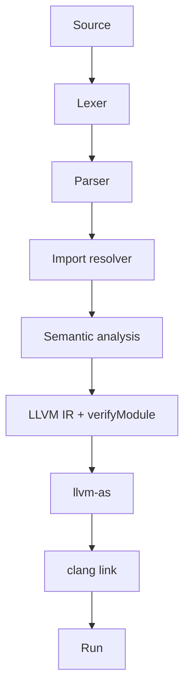

# tspp Compilation Pipeline

What happens when you run `tspp file.tspp`. Stage-by-stage code locations are
in [architecture.md](architecture.md).

1. **Lex** the source into tokens. Lexical errors (bad character, unterminated
   string, bad escape) stop compilation with `file:line:col`.
2. **Parse** into an AST. Unexpected tokens are reported with a location; the
   parser resynchronizes at the next statement so several errors can be
   reported. `enum` and `namespace` are rejected as not supported yet.
3. **Resolve imports**: `import X from "./file"` parses `file.tspp` and merges
   its declarations and statements in front of the importing file's.
4. **Check**: undeclared names, wrong argument counts, assignments to `const`,
   statements that parse but are not implemented yet (`switch`, `break`, ...).
5. **Generate LLVM IR**, then verify it with `llvm::verifyModule`. Invalid IR
   is reported as an internal compiler error (a compiler bug), never patched.
6. **Build**: write the IR into a private temp directory, check it with
   `llvm-as`, link with `clang -O3` against `libcore.a`, `-lgc`, `-lcurl`.
   Each step's exit status is checked; a failure names the stage and exits 1.
7. **Run** the program and exit with its status (skipped with `-o` or
   `--emit-llvm`). The temp directory is removed unless `--keep-temps`.

